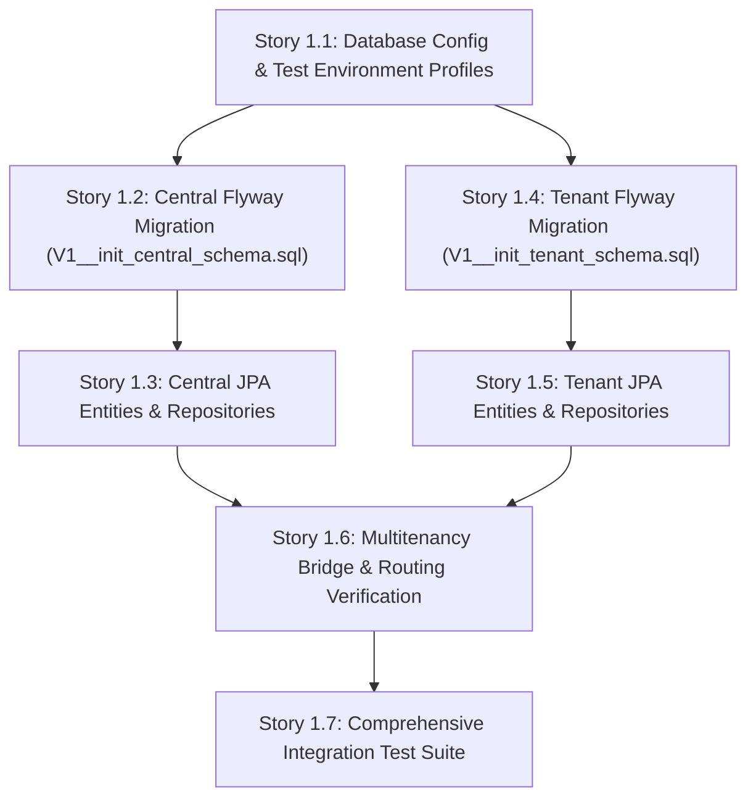

# GymVerse — Phase 1 Epic Breakdown: Enterprise Multi-Tenant Persistence Foundation (Refined)

## Overview

This document establishes the comprehensive, authoritative epic and story breakdown for **Phase 1: Enterprise Multi-Tenant Persistence Foundation** of `GymVerse-Backend-v2`. It incorporates forensic inspection of the existing multitenancy subsystem, strict alignment with [docs/architecture.md](file:///D:/projects/GymVerse-Backend-v2/docs/architecture.md) (Revision v2.2) and [PROMPT.md](file:///D:/projects/GymVerse-Backend-v2/PROMPT.md), and concrete technical specifications for database migrations, JPA entity models, repositories, connection routing, and automated integration testing.

---

## 1. Architectural & Configuration Inspection

### 1.1 Forensic Analysis of Protected Multitenancy Subsystem
The 8 core multitenancy classes in [`com.company.GymVerse.multitanancy`](file:///D:/projects/GymVerse-Backend-v2/src/main/java/com/company/GymVerse/multitanancy) represent a protected, verified baseline that **must remain completely unchanged**:

1. [`CentralJpaConfig.java`](file:///D:/projects/GymVerse-Backend-v2/src/main/java/com/company/GymVerse/multitanancy/CentralJpaConfig.java):
   - Configures the `@Primary` `centralEntityManagerFactory` (scanning `com.company.GymVerse.models.central`) and `@Primary` `centralTransactionManager`.
   - Injects the autoconfigured primary `DataSource` pointing to MySQL central database `${DB_URL}` (defaulting to `GymVerse`).
   - Uses `CamelCaseToUnderscoresNamingStrategy` and `hbm2ddl.auto = "none"`.
2. [`TenantJpaConfig.java`](file:///D:/projects/GymVerse-Backend-v2/src/main/java/com/company/GymVerse/multitanancy/TenantJpaConfig.java):
   - Configures `tenantEntityManagerFactory` (scanning `com.company.GymVerse.models.tenant`) and `tenantTransactionManager`.
   - Binds `GymVerseMultiTenantConnectionProvider` and `GymVerseCurrentTenantIdentifierResolver`.
   - Uses `CamelCaseToUnderscoresNamingStrategy` and `hbm2ddl.auto = "none"`.
   - Does not bind a static `DataSource`; Hibernate requests dynamic connections per request.
3. [`GymVerseCurrentTenantIdentifierResolver.java`](file:///D:/projects/GymVerse-Backend-v2/src/main/java/com/company/GymVerse/multitanancy/GymVerseCurrentTenantIdentifierResolver.java):
   - Reads `TenantContext.getCurrentTenant()`.
   - If non-null and non-blank, returns the tenant database name.
   - If null/blank, returns `CENTRAL_TENANT = "central"`.
4. [`GymVerseMultiTenantConnectionProvider.java`](file:///D:/projects/GymVerse-Backend-v2/src/main/java/com/company/GymVerse/multitanancy/GymVerseMultiTenantConnectionProvider.java):
   - Injects `TenantDataSourceCache` and `DataSource centralDataSource`.
   - On `@PostConstruct init()`, seeds the central datasource into cache under key `"central"`.
   - `getConnection(tenantIdentifier)`:
     - If `tenantIdentifier.equals("central")`, returns `centralDataSource.getConnection()`.
     - Otherwise, calls `dataSourceCache.getOrCreate(tenantIdentifier).getConnection()`.
   - `supportsAggressiveRelease()` returns `false` (retains connection across transaction lifecycle).
5. [`TenantDataSourceCache.java`](file:///D:/projects/GymVerse-Backend-v2/src/main/java/com/company/GymVerse/multitanancy/TenantDataSourceCache.java):
   - Maintains a thread-safe `ConcurrentHashMap<String, HikariDataSource>`.
   - `getOrCreate(dbName)` constructs a dynamic `HikariDataSource` pool targeting `jdbc:mysql://${gymverse.datasource.host:localhost}:${gymverse.datasource.port:3306}/<dbName>`.
   - Uses shared database credentials from `spring.datasource.username` and `spring.datasource.password`.
   - Pool parameters: `maxPoolSize = 5`, `minIdle = 1`, `connectionTimeout = 20s`, `idleTimeout = 300s`, `maxLifetime = 1200s`.
   - Exposes `evict(dbName)` which closes the pool and removes it from memory.
6. [`TenantDatabaseService.java`](file:///D:/projects/GymVerse-Backend-v2/src/main/java/com/company/GymVerse/multitanancy/TenantDatabaseService.java):
   - Injects `centralDataSource`.
   - Validates database names against `^[a-zA-Z0-9_]+$` to prevent SQL injection.
   - Executes administrative DDL: `CREATE DATABASE IF NOT EXISTS \`%s\` CHARACTER SET utf8mb4 COLLATE utf8mb4_unicode_ci` and `DROP DATABASE IF EXISTS \`%s\``.
7. [`TenantFlywayService.java`](file:///D:/projects/GymVerse-Backend-v2/src/main/java/com/company/GymVerse/multitanancy/TenantFlywayService.java):
   - Runs Flyway migrations targeting `classpath:db/migration/tenant` against the target database via `dataSourceCache.getOrCreate(tenantDbName)`.
   - Tracks migration history in `flyway_schema_history` within that tenant database.
8. [`TenantContext.java`](file:///D:/projects/GymVerse-Backend-v2/src/main/java/com/company/GymVerse/multitanancy/TenantContext.java):
   - Stores the active tenant database name in `InheritableThreadLocal<String>`.
   - Exposes static methods: `setCurrentTenant(dbName)`, `getCurrentTenant()`, and `clear()`.

---

### 1.2 Critical Tenant Transaction & Connection-Routing Lifecycle Rules (Correcting Story 1.6)

Because Spring's `JpaTransactionManager` acquires an `EntityManager` and begins the transaction at the `@Transactional` boundary, Hibernate resolves the current tenant identifier **at transaction initiation time**:

```
[Invocations / Outer Service / Bridge]
   │
   ├─► 1. Establish Tenant Context: TenantContext.setCurrentTenant(tenantDbName)
   │
   ├─► 2. Enter Tenant Transaction Boundary: @Transactional("tenantTransactionManager")
   │      │
   │      ├─► Hibernate asks GymVerseCurrentTenantIdentifierResolver
   │      │     └─► returns tenantDbName (from TenantContext)
   │      │
   │      ├─► Hibernate asks GymVerseMultiTenantConnectionProvider.getConnection(tenantDbName)
   │      │     └─► dataSourceCache.getOrCreate(tenantDbName).getConnection()
   │      │
   │      ├─► Execute Tenant JPA Repository Queries (e.g. MemberRepository, AttendanceRepository)
   │      │
   │      └─► Transaction Commits / Rolls back; Connection released to pool
   │
   └─► 3. Cleanup Tenant Context (MANDATORY IN FINALLY BLOCK): TenantContext.clear()
```

> [!CAUTION]
> **Severe Pitfall — Transaction Initiation Timing:**
> Calling `TenantContext.setCurrentTenant(dbName)` *inside* a method already marked `@Transactional("tenantTransactionManager")` is **ineffective**. Spring's transaction manager will have already asked Hibernate for the tenant identifier before method execution begins, resolving `"central"` and binding the central database connection.
> **Invariant:** `TenantContext.setCurrentTenant(tenantDbName)` must **always** be invoked **prior** to opening the tenant transaction boundary.

---

### 1.3 Schema Field & Architectural Verification Matrix

Every schema table, column, type, nullability, and constraint has been audited against [docs/architecture.md](file:///D:/projects/GymVerse-Backend-v2/docs/architecture.md) Sections 4.1 & 4.2 and [PROMPT.md](file:///D:/projects/GymVerse-Backend-v2/PROMPT.md):

#### Central Schema (`GymVerse`)

| Table Name | Column Name | Target SQL Type | Java JPA Type | Nullable | Constraints & Indexes | Architecture Alignment & Conflict Notes |
| :--- | :--- | :--- | :--- | :---: | :--- | :--- |
| `user_accounts` | `id` | `BIGINT` | `Long` | NO | `PRIMARY KEY AUTO_INCREMENT` | Matched. |
| | `email` | `VARCHAR(255)` | `String` | NO | `UNIQUE KEY uq_ua_email` | Matched. Single central identity. |
| | `first_name` | `VARCHAR(100)` | `String` | NO | None | Matched. |
| | `last_name` | `VARCHAR(100)` | `String` | NO | None | Matched. |
| | `password` | `VARCHAR(255)` | `String` | NO | None | Matched. BCrypt hash. |
| | `phone_number` | `VARCHAR(30)` | `String` | YES | None | Matched. |
| | `email_verified`| `BOOLEAN` | `boolean` | NO | `DEFAULT FALSE` | Matched. |
| | `is_platform_admin`| `BOOLEAN` | `boolean` | NO | `DEFAULT FALSE` | Matched. No separate owner role. |
| | `status` | `VARCHAR(30)` | `UserAccountStatus`| NO | `DEFAULT 'PENDING'` | Matched enum: PENDING, ACTIVE, SUSPENDED, DEACTIVATED. |
| | `created_at` | `DATETIME(6)` | `Instant` | NO | None | Matched UTC timestamp. |
| | `updated_at` | `DATETIME(6)` | `Instant` | NO | None | Matched UTC timestamp. |
| `gym_tenants` | `id` | `BIGINT` | `Long` | NO | `PRIMARY KEY AUTO_INCREMENT` | Matched. |
| | `gym_name` | `VARCHAR(200)` | `String` | NO | None | Matched. |
| | `contact_email`| `VARCHAR(255)` | `String` | NO | None | Matched. |
| | `phone_number` | `VARCHAR(30)` | `String` | YES | None | Matched. |
| | `address` | `VARCHAR(255)` | `String` | NO | None | Matched. |
| | `city` | `VARCHAR(100)` | `String` | NO | None | Matched. |
| | `logo_url` | `VARCHAR(500)` | `String` | YES | None | Matched. |
| | `gym_code` | `VARCHAR(50)` | `String` | NO | `UNIQUE KEY uq_gt_gym_code` | Matched. Client discovery key. |
| | `db_name` | `VARCHAR(100)` | `String` | NO | `UNIQUE KEY uq_gt_db_name` | Matched. Physical schema name. |
| | `status` | `VARCHAR(30)` | `GymStatus` | NO | `DEFAULT 'ACTIVE'` | Matched enum: ACTIVE, SUSPENDED, INACTIVE. |
| | `registered_at`| `DATETIME(6)` | `Instant` | NO | None | Matched. |
| | `suspended_at` | `DATETIME(6)` | `Instant` | YES | None | Matched. |
| | `suspension_reason`| `TEXT` | `String` | YES | None | Matched. |
| `user_tenant_roles`| `id` | `BIGINT` | `Long` | NO | `PRIMARY KEY AUTO_INCREMENT` | Matched. |
| | `user_account_id`| `BIGINT` | `Long` | NO | `FK -> user_accounts(id)` | Matched. |
| | `gym_tenant_id`| `BIGINT` | `Long` | NO | `FK -> gym_tenants(id)` | Matched. |
| | `role` | `VARCHAR(30)` | `TenantRole` | NO | None | Matched enum: TENANT_ADMIN, MEMBER, TRAINER, STAFF. |
| | `admin_authority`| `VARCHAR(30)`| `AdminAuthority`| NO | `DEFAULT 'NONE'` | Matched enum: PRIMARY, DELEGATED, NONE. |
| | `status` | `VARCHAR(30)` | `TenantMembershipStatus`| NO | `DEFAULT 'ACTIVE'` | Matched enum: ACTIVE, PENDING, SUSPENDED, REVOKED. |
| | `joined_at` | `DATETIME(6)` | `Instant` | NO | None | Matched. |
| | `updated_at` | `DATETIME(6)` | `Instant` | NO | None | Matched. |
| | *Constraints* | — | — | — | `UNIQUE KEY uq_utr_user_gym_role (user_account_id, gym_tenant_id, role)`<br/>`INDEX idx_utr_user_status (user_account_id, status)`<br/>`INDEX idx_utr_gym_role (gym_tenant_id, role, admin_authority)` | Primary Admin single-active rule is enforced via transactional logic + composite index. |
| `saas_subscription_plans`| `id` | `BIGINT` | `Long` | NO | `PRIMARY KEY AUTO_INCREMENT` | Matched. |
| | `name` | `VARCHAR(100)` | `String` | NO | None | Matched. |
| | `description` | `TEXT` | `String` | YES | None | Matched. |
| | `price` | **`DECIMAL(10,2)`**| **`BigDecimal`** | NO | None | **Conflict Resolved:** Architecture lists `DOUBLE`; enterprise rules dictate `DECIMAL(10,2)` / `BigDecimal`. |
| | `billing_cycle`| `VARCHAR(30)` | `BillingCycle` | NO | None | Matched enum: MONTHLY, QUARTERLY, ANNUAL. |
| | `max_members` | `INT` | `Integer` | NO | None | Matched. |
| | `max_trainers`| `INT` | `Integer` | NO | None | Matched. |
| | `analytics_enabled`| `BOOLEAN` | `boolean` | NO | `DEFAULT FALSE` | Matched. |
| | `multi_trainer_enabled`| `BOOLEAN` | `boolean` | NO | `DEFAULT FALSE` | Matched. |
| | `custom_branding_enabled`| `BOOLEAN`| `boolean` | NO | `DEFAULT FALSE` | Matched. |
| | `active` | `BOOLEAN` | `boolean` | NO | `DEFAULT TRUE` | Matched. |
| `gym_subscriptions`| `id` | `BIGINT` | `Long` | NO | `PRIMARY KEY AUTO_INCREMENT` | Matched. |
| | `gym_tenant_id`| `BIGINT` | `Long` | NO | `FK -> gym_tenants(id)` | Matched. |
| | `plan_id` | `BIGINT` | `Long` | NO | `FK -> saas_subscription_plans(id)` | Matched. |
| | `price_paid` | **`DECIMAL(10,2)`**| **`BigDecimal`** | NO | None | **Conflict Resolved:** Architecture lists `DOUBLE`; mandated `DECIMAL(10,2)` / `BigDecimal`. |
| | `billing_cycle`| `VARCHAR(30)` | `BillingCycle` | NO | None | Matched. |
| | `start_date` | `DATE` | `LocalDate` | NO | None | Matched. |
| | `end_date` | `DATE` | `LocalDate` | NO | None | Matched. |
| | `status` | `VARCHAR(30)` | `GymSubscriptionStatus`| NO | `DEFAULT 'TRIAL'` | Matched enum: TRIAL, ACTIVE, EXPIRED, CANCELLED. |
| | `subscribed_at`| `DATETIME(6)` | `Instant` | NO | None | Matched. |
| | `transaction_reference`| `VARCHAR(100)`| `String` | YES | None | Matched. |
| `admin_audit_logs`| `id` | `BIGINT` | `Long` | NO | `PRIMARY KEY AUTO_INCREMENT` | Matched. |
| | `gym_tenant_id`| `BIGINT` | `Long` | NO | `FK -> gym_tenants(id)` | Matched. |
| | `actor_user_account_id`| `BIGINT`| `Long` | NO | `FK -> user_accounts(id)` | Matched. |
| | `target_user_account_id`| `BIGINT`| `Long` | YES | `FK -> user_accounts(id)` | Matched. |
| | `action` | `VARCHAR(50)` | `AdminAuditEvent`| NO | None | Matched enum: APPOINT_DELEGATED_ADMIN, REVOKE_DELEGATED_ADMIN, TRANSFER_PRIMARY_AUTHORITY. |
| | `metadata` | `TEXT` | `String` | YES | None | Matched JSON string. |
| | `timestamp` | `DATETIME(6)` | `Instant` | NO | None | Matched. |

---

#### Tenant Operational Schema (`gym_db_<id>`)

| Table Name | Column Name | Target SQL Type | Java JPA Type | Nullable | Constraints & Indexes | Architecture Alignment & Conflict Notes |
| :--- | :--- | :--- | :--- | :---: | :--- | :--- |
| `users` | `id` | `BIGINT` | `Long` | NO | `PRIMARY KEY AUTO_INCREMENT` | Matched. |
| | `central_user_id`| `BIGINT` | `Long` | NO | `UNIQUE KEY uq_u_central_user_id` | **Scalar reference**; no physical cross-DB FK. |
| | `first_name` | `VARCHAR(100)` | `String` | NO | None | Matched. |
| | `last_name` | `VARCHAR(100)` | `String` | NO | None | Matched. |
| | `email` | `VARCHAR(255)` | `String` | NO | `UNIQUE KEY uq_u_email` | Matched. |
| | `phone_number` | `VARCHAR(30)` | `String` | YES | None | Matched. |
| | `role` | `VARCHAR(30)` | `TenantRole` | NO | None | Matched. |
| | `active` | `BOOLEAN` | `boolean` | NO | `DEFAULT TRUE` | Matched. |
| | `created_at` | `DATETIME(6)` | `Instant` | NO | None | Matched. |
| | *Passwords* | **OMITTED** | **OMITTED** | — | — | **MANDATORY INVARIANT:** Zero password columns. |
| `gym_config` | `id` | `BIGINT` | `Long` | NO | `PRIMARY KEY AUTO_INCREMENT` | Matched. |
| | `latitude` | `DECIMAL(10,8)`| `Double` | NO | None | Matched geofence center. |
| | `longitude` | `DECIMAL(11,8)`| `Double` | NO | None | Matched geofence center. |
| | `radius` | `DOUBLE` | `Double` | NO | None | Matched radius in meters. |
| | `time_zone` | `VARCHAR(50)` | `String` | NO | `DEFAULT 'UTC'` | Matched. |
| | `opening_time` | `TIME` | `LocalTime` | NO | None | Matched. |
| | `closing_time` | `TIME` | `LocalTime` | NO | None | Matched. |
| | `auto_checkout_time`| `TIME` | `LocalTime` | YES | None | Matched. |
| `members` | `id` | `BIGINT` | `Long` | NO | `PRIMARY KEY AUTO_INCREMENT` | Matched. |
| | `user_id` | `BIGINT` | `Long` | NO | `FK -> users(id)`, `UNIQUE KEY uq_m_user_id` | Matched 1:1 profile relationship. |
| | `trainer_id` | `BIGINT` | `Long` | YES | `FK -> users(id)` | Matched assigned trainer. |
| | `independent` | `BOOLEAN` | `boolean` | NO | `DEFAULT FALSE` | Matched. |
| | `height` | `DECIMAL(5,2)` | `Double` | YES | None | Matched height in cm. |
| | `weight` | `DECIMAL(5,2)` | `Double` | YES | None | Matched weight in kg. |
| | `goal` | `VARCHAR(255)` | `String` | YES | None | Matched fitness goal. |
| | `join_date` | `DATE` | `LocalDate` | NO | None | Matched. |
| | `gym_id` | `VARCHAR(50)` | `String` | YES | `UNIQUE KEY uq_m_gym_id` | Matched external badge ID (nullable). |
| | `type` | `VARCHAR(50)` | `String` | YES | None | Matched member tier/type. |
| | `trial_end_date`| `DATE` | `LocalDate` | YES | None | Matched. |
| | `specialization`| `VARCHAR(100)`| `String` | YES | None | Matched. |
| `membership_plans`| `id` | `BIGINT` | `Long` | NO | `PRIMARY KEY AUTO_INCREMENT` | Matched. |
| | `name` | `VARCHAR(100)` | `String` | NO | None | Matched. |
| | `description` | `TEXT` | `String` | YES | None | Matched. |
| | `tier` | `VARCHAR(50)` | `String` | YES | None | Matched. |
| | `facility` | `VARCHAR(100)` | `String` | YES | None | Matched. |
| | `base_price` | **`DECIMAL(10,2)`**| **`BigDecimal`** | NO | None | **Conflict Resolved:** Mandated `DECIMAL(10,2)` / `BigDecimal`. |
| | `discount_type`| `VARCHAR(30)` | `String` | YES | None | Matched percentage or fixed. |
| | `discount_value`| **`DECIMAL(10,2)`**| **`BigDecimal`** | YES | None | **Conflict Resolved:** Mandated `DECIMAL(10,2)` / `BigDecimal`. |
| | `final_price` | **`DECIMAL(10,2)`**| **`BigDecimal`** | NO | None | **Conflict Resolved:** Mandated `DECIMAL(10,2)` / `BigDecimal`. |
| | `duration_days`| `INT` | `Integer` | NO | None | Matched plan length. |
| | `active` | `BOOLEAN` | `boolean` | NO | `DEFAULT TRUE` | Matched. |
| `member_memberships`| `id` | `BIGINT` | `Long` | NO | `PRIMARY KEY AUTO_INCREMENT` | Matched. |
| | `member_id` | `BIGINT` | `Long` | NO | `FK -> members(id)` | Matched. |
| | `plan_id` | `BIGINT` | `Long` | NO | `FK -> membership_plans(id)` | Matched. |
| | `price_at_purchase`| **`DECIMAL(10,2)`**| **`BigDecimal`**| NO | None | **Conflict Resolved:** Mandated `DECIMAL(10,2)` / `BigDecimal`. |
| | `discount_type`| `VARCHAR(30)` | `String` | YES | None | Matched. |
| | `discount_value`| **`DECIMAL(10,2)`**| **`BigDecimal`**| YES | None | **Conflict Resolved:** Mandated `DECIMAL(10,2)` / `BigDecimal`. |
| | `final_price` | **`DECIMAL(10,2)`**| **`BigDecimal`**| NO | None | **Conflict Resolved:** Mandated `DECIMAL(10,2)` / `BigDecimal`. |
| | `start_date` | `DATE` | `LocalDate` | NO | None | Matched. |
| | `end_date` | `DATE` | `LocalDate` | NO | None | Matched. |
| | `active` | `BOOLEAN` | `boolean` | NO | `DEFAULT TRUE` | Matched. |
| `membership_requests`| `id` | `BIGINT` | `Long` | NO | `PRIMARY KEY AUTO_INCREMENT` | Matched. |
| | `user_id` | `BIGINT` | `Long` | NO | `FK -> users(id)` | Matched. |
| | `plan_id` | `BIGINT` | `Long` | NO | `FK -> membership_plans(id)`| Matched. |
| | `status` | `VARCHAR(30)` | `String` | NO | `DEFAULT 'PENDING'` | Matched: PENDING, APPROVED, REJECTED. |
| | `request_date` | `DATETIME(6)` | `Instant` | NO | None | Matched. |
| | `member_notes` | `TEXT` | `String` | YES | None | Matched. |
| | `admin_notes` | `TEXT` | `String` | YES | None | Matched. |
| | `reviewed_at` | `DATETIME(6)` | `Instant` | YES | None | Matched. |
| | `reviewed_by_admin_id`| `BIGINT`| `Long` | YES | `FK -> users(id)` | Matched. |
| `attendance` | `id` | `BIGINT` | `Long` | NO | `PRIMARY KEY AUTO_INCREMENT` | Matched. |
| | `member_id` | `BIGINT` | `Long` | NO | `FK -> members(id)` | Matched. |
| | `date` | `DATE` | `LocalDate` | NO | None | Matched attendance date. |
| | `check_in_time`| `DATETIME(6)` | `Instant` | NO | None | Matched GPS check-in. |
| | `check_out_time`| `DATETIME(6)`| `Instant` | YES | None | Matched. |
| | `auto_checked_out`| `BOOLEAN` | `boolean` | NO | `DEFAULT FALSE` | Matched end-of-day sweep flag. |
| | `status` | `VARCHAR(30)` | `String` | NO | None | Matched: PRESENT, CHECKED_OUT, AUTO_CHECKED_OUT. |
| `revenue` | `id` | `BIGINT` | `Long` | NO | `PRIMARY KEY AUTO_INCREMENT` | Matched. |
| | `member_membership_id`| `BIGINT`| `Long` | NO | `FK -> member_memberships(id)`, `UNIQUE KEY` | Matched 1:1 payment record. |
| | `amount` | **`DECIMAL(10,2)`**| **`BigDecimal`** | NO | None | **Conflict Resolved:** Mandated `DECIMAL(10,2)` / `BigDecimal`. |
| | `payment_mode` | `VARCHAR(50)` | `String` | NO | None | Matched. |
| | `transaction_reference`| `VARCHAR(100)`| `String`| YES | None | Matched. |
| | `received_at` | `DATETIME(6)` | `Instant` | NO | None | Matched. |
| | `recorded_by_admin_id`| `BIGINT`| `Long` | YES | `FK -> users(id)` | Matched. |
| `expenses` | `id` | `BIGINT` | `Long` | NO | `PRIMARY KEY AUTO_INCREMENT` | Matched. |
| | `title` | `VARCHAR(200)` | `String` | NO | None | Matched. |
| | `description` | `TEXT` | `String` | YES | None | Matched. |
| | `amount` | **`DECIMAL(10,2)`**| **`BigDecimal`** | NO | None | **Conflict Resolved:** Mandated `DECIMAL(10,2)` / `BigDecimal`. |
| | `category` | `VARCHAR(50)` | `String` | NO | None | Matched expense category. |
| | `expense_date` | `DATE` | `LocalDate` | NO | None | Matched. |
| | `recorded_by_admin_id`| `BIGINT`| `Long` | YES | `FK -> users(id)` | Matched. |
| `join_requests` | `id` | `BIGINT` | `Long` | NO | `PRIMARY KEY AUTO_INCREMENT` | Matched. |
| | `central_user_id`| `BIGINT` | `Long` | NO | None | **Scalar reference**; no physical cross-DB FK. |
| | `email` | `VARCHAR(255)` | `String` | NO | None | Matched. |
| | `first_name` | `VARCHAR(100)` | `String` | YES | None | Matched. |
| | `last_name` | `VARCHAR(100)` | `String` | YES | None | Matched. |
| | `phone_number` | `VARCHAR(30)` | `String` | YES | None | Matched. |
| | `status` | `VARCHAR(30)` | `String` | NO | `DEFAULT 'PENDING'` | Matched: PENDING, APPROVED, REJECTED. |
| | `request_notes`| `TEXT` | `String` | YES | None | Matched applicant notes. |
| | `admin_notes` | `TEXT` | `String` | YES | None | Matched admin review notes. |
| | `created_at` | `DATETIME(6)` | `Instant` | NO | None | Matched. |
| | `reviewed_at` | `DATETIME(6)` | `Instant` | YES | None | Matched. |
| | `reviewed_by_admin_id`| `BIGINT`| `Long` | YES | `FK -> users(id)` | Matched. |
| `gym_invitations`| `id` | `BIGINT` | `Long` | NO | `PRIMARY KEY AUTO_INCREMENT` | Matched. |
| | `email` | `VARCHAR(255)` | `String` | NO | None | Matched. |
| | `role` | `VARCHAR(30)` | `TenantRole` | NO | None | Matched role offer. |
| | `invitation_token`| `VARCHAR(255)`| `String` | NO | `UNIQUE KEY uq_gi_invitation_token` | **SECURITY FLAG:** Plaintext bearer tokens flagged; recommend hashed storage (`invitation_token_hash VARCHAR(64)`). |
| | `status` | `VARCHAR(30)` | `String` | NO | `DEFAULT 'PENDING'` | Matched: PENDING, ACCEPTED, EXPIRED, REVOKED. |
| | `expires_at` | `DATETIME(6)` | `Instant` | NO | None | Matched expiration timestamp. |
| | `created_at` | `DATETIME(6)` | `Instant` | NO | None | Matched. |
| | `accepted_at` | `DATETIME(6)` | `Instant` | YES | None | Matched. |
| | `created_by_admin_id`| `BIGINT`| `Long` | YES | `FK -> users(id)` | Matched. |
| `friend_requests`| `id` | `BIGINT` | `Long` | NO | `PRIMARY KEY AUTO_INCREMENT` | Matched. |
| | `sender_member_id`| `BIGINT` | `Long` | NO | `FK -> members(id)` | Matched. |
| | `receiver_member_id`| `BIGINT`| `Long` | NO | `FK -> members(id)` | Matched. |
| | `status` | `VARCHAR(30)` | `String` | NO | `DEFAULT 'PENDING'` | Matched: PENDING, ACCEPTED, REJECTED. |
| | *Constraints* | — | — | — | `UNIQUE KEY uq_fr_sender_receiver (sender_member_id, receiver_member_id)` | Matched. |
| `custom_friends` | `id` | `BIGINT` | `Long` | NO | `PRIMARY KEY AUTO_INCREMENT` | Matched. |
| | `user_member_id`| `BIGINT` | `Long` | NO | `FK -> members(id)` | Matched. |
| | `friend_member_id`| `BIGINT`| `Long` | NO | `FK -> members(id)` | Matched. |
| | `created_at` | `DATETIME(6)` | `Instant` | NO | None | Matched. |
| | *Constraints* | — | — | — | `UNIQUE KEY uq_cf_pair (user_member_id, friend_member_id)` | Matched. |
| `friend_streaks` | `id` | `BIGINT` | `Long` | NO | `PRIMARY KEY AUTO_INCREMENT` | Matched. |
| | `member1_id` | `BIGINT` | `Long` | NO | `FK -> members(id)` | Matched. |
| | `member2_id` | `BIGINT` | `Long` | NO | `FK -> members(id)` | Matched. |
| | `current_streak`| `INT` | `Integer` | NO | `DEFAULT 0` | Matched. |
| | `longest_streak`| `INT` | `Integer` | NO | `DEFAULT 0` | Matched. |
| | `last_streak_date`| `DATE` | `LocalDate` | YES | None | Matched. |
| | `together_check_ins`| `INT` | `Integer` | NO | `DEFAULT 0` | Matched. |
| | `together_check_outs`| `INT`| `Integer` | NO | `DEFAULT 0` | Matched. |
| | `last_checkout_together_date`| `DATE`| `LocalDate`| YES | None | Matched. |
| | *Constraints* | — | — | — | `UNIQUE KEY uq_fs_members (member1_id, member2_id)` | Matched. |

---

### 1.4 Security Flag: Invitation Token Storage (Plaintext vs. Hashed)
- **Current Architecture Specification:** `gym_invitations.invitation_token VARCHAR UK` stores tokens directly.
- **Security Assessment:** Bearer invitation tokens grant administrative, staff, trainer, or member privileges upon redemption. Storing raw tokens in plaintext makes invitations susceptible to abuse if the database is read or dumped unauthorizedly.
- **Architectural Recommendation:**
  - Store a one-way cryptographic hash of the token: `invitation_token_hash VARCHAR(64) NOT NULL UNIQUE` (SHA-256).
  - During issuance, generate high-entropy random token, send plaintext to invitee via email, and store SHA-256 hex digest in DB.
  - During redemption, hash the client-supplied token and perform `findByInvitationTokenHash(hash)`.
  - For Phase 1 schema creation, define column `invitation_token_hash VARCHAR(64) NOT NULL UNIQUE` (or `invitation_token VARCHAR(255) NOT NULL UNIQUE` designated as holding the hash).

---

## 2. Refined Phase 1 Epic & Story Breakdown

### Epic 1: Phase 1 — Enterprise Multi-Tenant Persistence Foundation

**Epic Goal:** Deliver a production-grade, thoroughly verified persistence foundation for the GymVerse modular monolith across both central and tenant databases, including Flyway migrations, JPA entity models, repositories, dynamic database routing, and automated integration tests demonstrating tenant isolation.

---

#### Story 1.1: Database Configuration & Test Environment Profiles
**User Story:**  
As a backend engineer,  
I want unified, sanitized configuration profiles for central and tenant datasources,  
So that the application connects reliably to the central database and manages tenant connection pools across development, testing, and production environments.

**Prerequisites:**  
Existing `GymVerse-Backend-v2` project scaffold with Spring Boot 3.3.5, Java 21, and intact multitenancy package.

**Acceptance Criteria:**
1. **Given** the application startup configuration,  
   **When** `application.yaml` is evaluated,  
   **Then** central datasource parameters point to `${DB_URL}` with sensible local defaults, multitenancy host/port properties (`gymverse.datasource.host`, `gymverse.datasource.port`) are externalized, and Flyway central migration location is set to `classpath:db/migration/central`.
2. **Given** automated testing requirements,  
   **When** `src/test/resources/application-test.yaml` is evaluated under active profile `test`,  
   **Then** it defines isolated test database credentials, disables external Kafka consumer/producer initialization (`spring.kafka.listener.auto-startup: false`), disables mail connection probing, and configures test connection pool timeouts.
3. **Given** Flyway configuration in `application.yaml`,  
   **When** Spring Boot initializes,  
   **Then** `spring.flyway.enabled: true` applies strictly to the central datasource (`classpath:db/migration/central`), while tenant migrations remain deferred to programmatic execution via `TenantFlywayService`.

**Files Affected:**
- `src/main/resources/application.yaml`
- `src/test/resources/application-test.yaml`

**Verification Command:**
```powershell
./mvnw test-compile
```

**Definition of Done:**
Configuration profiles compile cleanly, environment variables fall back to valid local development defaults, and test profiles prevent external service dependency blocking.

---

#### Story 1.2: Central Database Flyway Migration (`V1__init_central_schema.sql`)
**User Story:**  
As a database architect,  
I want an authoritative Flyway migration script for the central platform database,  
So that all shared platform tables, foreign keys, indexes, unique constraints, and monetary types are deterministically created and verified on application startup.

**Prerequisites:**  
Story 1.1 completed.

**Acceptance Criteria:**
1. **Given** a clean MySQL server with database `GymVerse`,  
   **When** Flyway executes against the central datasource,  
   **Then** `V1__init_central_schema.sql` creates all 6 central tables:
   - `user_accounts` (PK `id`, UK `email`, `first_name`, `last_name`, `password`, `phone_number`, `email_verified`, `is_platform_admin`, `status`, `created_at`, `updated_at`).
   - `gym_tenants` (PK `id`, UK `gym_code`, UK `db_name`, `gym_name`, `contact_email`, `phone_number`, `address`, `city`, `logo_url`, `status`, `registered_at`, `suspended_at`, `suspension_reason`).
   - `user_tenant_roles` (PK `id`, FK `user_account_id` -> `user_accounts(id)`, FK `gym_tenant_id` -> `gym_tenants(id)`, `role`, `admin_authority`, `status`, `joined_at`, `updated_at`, `UNIQUE KEY uq_utr_user_gym_role (user_account_id, gym_tenant_id, role)`).
   - `saas_subscription_plans` (PK `id`, `name`, `description`, **`price DECIMAL(10,2) NOT NULL`**, `billing_cycle`, `max_members`, `max_trainers`, `analytics_enabled`, `multi_trainer_enabled`, `custom_branding_enabled`, `active`).
   - `gym_subscriptions` (PK `id`, FK `gym_tenant_id`, FK `plan_id`, **`price_paid DECIMAL(10,2) NOT NULL`**, `billing_cycle`, `start_date`, `end_date`, `status`, `subscribed_at`, `transaction_reference`).
   - `admin_audit_logs` (PK `id`, FK `gym_tenant_id`, FK `actor_user_account_id`, FK `target_user_account_id`, `action`, `metadata`, `timestamp`).
2. **Given** index requirements,  
   **Then** `idx_utr_user_status (user_account_id, status)`, `idx_utr_gym_role (gym_tenant_id, role, admin_authority)`, `idx_gym_code (gym_code)`, and `idx_db_name (db_name)` are created.
3. **Given** MySQL character encoding,  
   **Then** all tables specify `ENGINE=InnoDB DEFAULT CHARSET=utf8mb4 COLLATE=utf8mb4_unicode_ci`.
4. **Given** execution against a live MySQL database,  
   **Then** `flyway_schema_history` successfully logs the migration with `success = 1` and matching checksum.

**Files Affected:**
- `src/main/resources/db/migration/central/V1__init_central_schema.sql`

**Verification Command:**
```powershell
./mvnw test -Dtest=CentralPersistenceIntegrationTest
```

**Definition of Done:**
The migration executes cleanly on a real MySQL server without warnings or errors, creates exact schemas matching the Section 1.3 matrix, and generates a recorded Flyway entry.

---

#### Story 1.3: Central JPA Entities and Repositories
**User Story:**  
As a backend engineer,  
I want JPA entities and Spring Data repositories for the central platform domain,  
So that the application can perform type-safe persistence operations against `user_accounts`, `gym_tenants`, `user_tenant_roles`, and SaaS subscription tables under `centralTransactionManager`.

**Prerequisites:**  
Story 1.2 completed.

**Acceptance Criteria:**
1. **Given** `com.company.GymVerse.models.central`,  
   **When** entities are scanned by `centralEntityManagerFactory`,  
   **Then** `UserAccount`, `GymTenant`, `UserTenantRole`, `SaasSubscriptionPlan`, `GymSubscription`, and `AdminAuditLog` map to their respective central tables using `CamelCaseToUnderscoresNamingStrategy`.
2. **Given** monetary fields in central entities,  
   **Then** `SaasSubscriptionPlan.price` and `GymSubscription.pricePaid` are strictly typed as `BigDecimal` with `@Column(precision = 10, scale = 2, nullable = false)`.
3. **Given** central enums,  
   **Then** `UserAccountStatus`, `GymStatus`, `TenantRole`, `AdminAuthority`, `TenantMembershipStatus`, `BillingCycle`, `GymSubscriptionStatus`, and `AdminAuditEvent` are mapped via `@Enumerated(EnumType.STRING)`.
4. **Given** `com.company.GymVerse.repositories.central`,  
   **When** repositories are injected,  
   **Then** Spring Data JPA provides:
   - `UserAccountRepository`: `findByEmail(String email)`, `existsByEmail(String email)`.
   - `GymTenantRepository`: `findByGymCode(String code)`, `findByDbName(String dbName)`, `existsByGymCode(String code)`, `existsByDbName(String dbName)`.
   - `UserTenantRoleRepository`: `findByUserAccountIdAndGymTenantId(Long userId, Long gymId)`, `findByUserAccountIdAndGymTenantIdAndRole(Long userId, Long gymId, TenantRole role)`.
   - `SaasSubscriptionPlanRepository`: `findByActiveTrue()`.
   - `GymSubscriptionRepository`: `findTopByGymTenantIdAndStatusOrderByEndDateDesc(Long tenantId, GymSubscriptionStatus status)`.
   - `AdminAuditLogRepository`: `findByGymTenantIdOrderByTimestampDesc(Long tenantId)`.
5. **Given** `CentralJpaConfig`,  
   **When** repositories execute CRUD operations under `@Transactional("centralTransactionManager")`,  
   **Then** records persist to MySQL `GymVerse`, and constraint violations (e.g. duplicate email, duplicate gym code) trigger `DataIntegrityViolationException`.

**Files Affected:**
- `src/main/java/com/company/GymVerse/models/central/*.java`
- `src/main/java/com/company/GymVerse/models/central/enums/*.java`
- `src/main/java/com/company/GymVerse/repositories/central/*.java`

**Verification Command:**
```powershell
./mvnw test -Dtest=CentralPersistenceIntegrationTest
```

**Definition of Done:**
All central entity and repository classes compile cleanly, are verified via integration tests against live MySQL, and adhere strictly to constructor injection and Lombok conventions.

---

#### Story 1.4: Tenant Database Flyway Migration (`V1__init_tenant_schema.sql`)
**User Story:**  
As a database architect,  
I want an authoritative Flyway migration script for tenant-specific databases,  
So that every dynamically provisioned gym database (`gym_db_<id>`) contains a clean, standardized schema with complete operational tables, monetary precision, and zero stored passwords.

**Prerequisites:**  
Story 1.1 completed.

**Acceptance Criteria:**
1. **Given** an empty tenant database created by `TenantDatabaseService`,  
   **When** `TenantFlywayService.migrate(tenantDbName)` is executed,  
   **Then** `V1__init_tenant_schema.sql` creates all 14 tenant tables:
   - `users` (PK `id`, UK `central_user_id`, UK `email`, `first_name`, `last_name`, `phone_number`, `role`, `active`, `created_at`) — **MUST NOT contain a password column**.
   - `gym_config` (PK `id`, `latitude DECIMAL(10,8)`, `longitude DECIMAL(11,8)`, `radius DOUBLE`, `time_zone`, `opening_time`, `closing_time`, `auto_checkout_time`).
   - `members` (PK `id`, UK `user_id` FK, `trainer_id` FK nullable, `independent`, `height DECIMAL(5,2)`, `weight DECIMAL(5,2)`, `goal`, `join_date`, `gym_id` UK nullable, `type`, `trial_end_date`, `specialization`).
   - `membership_plans` (PK `id`, `name`, `description`, `tier`, `facility`, **`base_price DECIMAL(10,2) NOT NULL`**, `discount_type`, **`discount_value DECIMAL(10,2)`**, **`final_price DECIMAL(10,2) NOT NULL`**, `duration_days`, `active`).
   - `member_memberships` (PK `id`, FK `member_id`, FK `plan_id`, **`price_at_purchase DECIMAL(10,2) NOT NULL`**, `discount_type`, **`discount_value DECIMAL(10,2)`**, **`final_price DECIMAL(10,2) NOT NULL`**, `start_date`, `end_date`, `active`).
   - `membership_requests` (PK `id`, FK `user_id`, FK `plan_id`, `status`, `request_date`, `member_notes`, `admin_notes`, `reviewed_at`, `reviewed_by_admin_id`).
   - `attendance` (PK `id`, FK `member_id`, `date`, `check_in_time`, `check_out_time`, `auto_checked_out`, `status`).
   - `revenue` (PK `id`, UK `member_membership_id` FK, **`amount DECIMAL(10,2) NOT NULL`**, `payment_mode`, `transaction_reference`, `received_at`, `recorded_by_admin_id`).
   - `expenses` (PK `id`, `title`, `description`, **`amount DECIMAL(10,2) NOT NULL`**, `category`, `expense_date`, `recorded_by_admin_id`).
   - `join_requests` (PK `id`, `central_user_id BIGINT NOT NULL`, `email`, `first_name`, `last_name`, `phone_number`, `status`, `request_notes`, `admin_notes`, `created_at`, `reviewed_at`, `reviewed_by_admin_id`).
   - `gym_invitations` (PK `id`, `email`, `role`, `invitation_token VARCHAR(255) UK` [or `invitation_token_hash VARCHAR(64) UK`], `status`, `expires_at`, `created_at`, `accepted_at`, `created_by_admin_id`).
   - `friend_requests` (PK `id`, `sender_member_id` FK, `receiver_member_id` FK, `status`, `UNIQUE KEY uq_fr_sender_receiver (sender_member_id, receiver_member_id)`).
   - `custom_friends` (PK `id`, `user_member_id` FK, `friend_member_id` FK, `created_at`, `UNIQUE KEY uq_cf_pair (user_member_id, friend_member_id)`).
   - `friend_streaks` (PK `id`, `member1_id` FK, `member2_id` FK, `current_streak`, `longest_streak`, `last_streak_date`, `together_check_ins`, `together_check_outs`, `last_checkout_together_date`, `UNIQUE KEY uq_fs_members (member1_id, member2_id)`).
2. **Given** schema isolation,  
   **Then** all foreign keys exist strictly within the local tenant database; `central_user_id` fields are scalar `BIGINT` without physical cross-database foreign key constraints.
3. **Given** execution via `TenantFlywayService`,  
   **Then** `flyway_schema_history` inside the target tenant database records successful execution.

**Files Affected:**
- `src/main/resources/db/migration/tenant/V1__init_tenant_schema.sql`

**Verification Command:**
```powershell
./mvnw test -Dtest=TenantPersistenceIntegrationTest
```

**Definition of Done:**
Migration script resides in `src/main/resources/db/migration/tenant/`, executes cleanly via `TenantFlywayService.migrate(tenantDbName)`, and establishes the complete tenant schema.

---

#### Story 1.5: Tenant-Local JPA Entities and Repositories
**User Story:**  
As a backend engineer,  
I want JPA entities and Spring Data repositories for the tenant operational domain,  
So that gym-specific modules can perform type-safe operations against member records, attendance logs, and financial records within the currently routed tenant database under `tenantTransactionManager`.

**Prerequisites:**  
Story 1.4 completed.

**Acceptance Criteria:**
1. **Given** `com.company.GymVerse.models.tenant`,  
   **When** entities are scanned by `tenantEntityManagerFactory`,  
   **Then** `TenantUser`, `GymConfig`, `Member`, `MembershipPlan`, `MemberMembership`, `MembershipRequest`, `Attendance`, `Revenue`, `Expense`, `JoinRequest`, `GymInvitation`, `FriendRequest`, `CustomFriend`, and `FriendStreak` represent all tenant tables.
2. **Given** credential isolation,  
   **Then** `TenantUser` contains scalar `Long centralUserId`, `email`, `firstName`, `lastName`, `role`, and `active`, but contains **no password field**.
3. **Given** monetary fields in tenant entities,  
   **Then** `MembershipPlan.basePrice`, `MembershipPlan.discountValue`, `MembershipPlan.finalPrice`, `MemberMembership.priceAtPurchase`, `MemberMembership.discountValue`, `MemberMembership.finalPrice`, `Revenue.amount`, and `Expense.amount` are typed as `BigDecimal` with `@Column(precision = 10, scale = 2)`.
4. **Given** `com.company.GymVerse.repositories.tenant`,  
   **When** repositories are injected,  
   **Then** Spring Data JPA provides:
   - `TenantUserRepository`: `findByCentralUserId(Long centralUserId)`, `findByEmail(String email)`.
   - `GymConfigRepository`: `findTopByOrderByIdAsc()`.
   - `MemberRepository`: `findByUserId(Long userId)`, `findByTrainerId(Long trainerId)`.
   - `MembershipPlanRepository`: `findByActiveTrue()`.
   - `MemberMembershipRepository`: `findByMemberIdAndActiveTrue(Long memberId)`.
   - `MembershipRequestRepository`: `findByUserId(Long userId)`, `findByStatus(String status)`.
   - `AttendanceRepository`: `findByMemberIdAndDate(Long memberId, LocalDate date)`.
   - `RevenueRepository`: `findByReceivedAtBetween(Instant start, Instant end)`.
   - `ExpenseRepository`: `findByExpenseDateBetween(LocalDate start, LocalDate end)`.
   - `JoinRequestRepository`: `findByCentralUserId(Long centralUserId)`, `findByStatus(String status)`.
   - `GymInvitationRepository`: `findByInvitationToken(String token)`, `findByEmailAndStatus(String email, String status)`.
   - `FriendRequestRepository`, `CustomFriendRepository`, `FriendStreakRepository`.
5. **Given** `TenantJpaConfig`,  
   **When** repositories execute inside an established tenant context under `@Transactional("tenantTransactionManager")`,  
   **Then** queries are executed against the routed tenant database and entities map with zero exceptions.

**Files Affected:**
- `src/main/java/com/company/GymVerse/models/tenant/*.java`
- `src/main/java/com/company/GymVerse/repositories/tenant/*.java`

**Verification Command:**
```powershell
./mvnw test -Dtest=TenantPersistenceIntegrationTest
```

**Definition of Done:**
All tenant entities and repositories compile cleanly, contain no cross-database object relationships, use `BigDecimal` for monetary amounts, and bind to `tenantEntityManagerFactory`.

---

#### Story 1.6: Multitenancy Bridge Integration & Tenant Routing Verification
**User Story:**  
As a backend engineer,  
I want a verified application-to-database routing bridge that derives transaction boundaries and connection-routing strictly from the actual multitenancy classes,  
So that tenant operations establish context before transaction initiation, execute against the targeted tenant database, and guarantee cleanup in finally blocks without modifying protected classes.

**Prerequisites:**  
Story 1.3 and Story 1.5 completed.

**Acceptance Criteria:**
1. **Given** the 8 protected multitenancy classes in `com.company.GymVerse.multitanancy`,  
   **When** verified against source hashes,  
   **Then** all 8 classes remain 100% bit-for-bit unchanged.
2. **Given** tenant transaction lifecycle requirements,  
   **When** executing tenant-scoped operations,  
   **Then** the execution flow enforces:
   - **Step 1:** Establish tenant context *before* transaction initiation: `TenantContext.setCurrentTenant(tenantDbName)`.
   - **Step 2:** Initiate tenant transaction: `tenantTransactionManager` invokes Hibernate, which calls `GymVerseCurrentTenantIdentifierResolver.resolveCurrentTenantIdentifier()` -> resolves `tenantDbName`.
   - **Step 3:** Connection acquisition: `GymVerseMultiTenantConnectionProvider` acquires a connection from `TenantDataSourceCache.getOrCreate(tenantDbName)`.
   - **Step 4:** Transaction executes queries via tenant repositories.
   - **Step 5 (Cleanup Invariant):** `TenantContext.clear()` is guaranteed to execute in a `finally` block *after* transaction completion, preventing ThreadLocal leakage across thread pools.
3. **Given** central operations without tenant context,  
   **When** executed under `@Transactional("centralTransactionManager")`,  
   **Then** `GymVerseCurrentTenantIdentifierResolver` falls back to `CENTRAL_TENANT = "central"` and queries execute directly on the central datasource.
4. **Given** an infrastructure routing bridge component (`TenantRoutingBridge` in a service/infrastructure package),  
   **When** wrapping tenant actions via `executeInTenant(String tenantDbName, Consumer/Supplier action)`,  
   **Then** it programmatically enforces the pre-transaction context setup, transactional execution, and `finally` cleanup sequence.

**Files Affected:**
- `src/main/java/com/company/GymVerse/multitanancy/` (zero modifications to existing 8 files)
- `src/main/java/com/company/GymVerse/multitanancy/TenantRoutingBridge.java` (new helper service, or bridge in `service/`)

**Verification Command:**
```powershell
./mvnw test -Dtest=TenantIsolationIntegrationTest
```

**Definition of Done:**
Routing bridge enforces pre-transaction context establishment, proper connection resolution via existing cache, transaction execution under `tenantTransactionManager`, and unconditional ThreadLocal cleanup in a `finally` block.

---

#### Story 1.7: Comprehensive Integration Test Suite (Context Startup, Migrations & Isolation)
**User Story:**  
As a quality engineer,  
I want an automated integration test suite covering schema migrations, central persistence, tenant persistence, and physical tenant isolation,  
So that we have definitive, reproducible proof that the dual-database architecture operates correctly against MySQL with complete cleanup of test resources.

**Prerequisites:**  
Stories 1.1 through 1.6 completed.

**Acceptance Criteria:**
1. **Given** `ApplicationContextStartupIntegrationTest` (or `ApplicationTests`),  
   **When** executed with the `test` profile,  
   **Then** the Spring Boot application context initializes successfully with both `centralEntityManagerFactory` and `tenantEntityManagerFactory` beans, and both `centralTransactionManager` and `tenantTransactionManager` active.
2. **Given** `CentralPersistenceIntegrationTest`,  
   **When** executed against the MySQL central database,  
   **Then**:
   - Central Flyway migration executes automatically.
   - `UserAccount`, `GymTenant`, and `UserTenantRole` entities can be saved, updated, and queried.
   - Unique constraints on `user_accounts.email`, `gym_tenants.gym_code`, and `user_tenant_roles(user_account_id, gym_tenant_id, role)` are verified.
3. **Given** `TenantPersistenceIntegrationTest`,  
   **When** executed for a test tenant,  
   **Then**:
   - `TenantDatabaseService.createDatabase("gym_db_test_001")` creates the database.
   - `TenantFlywayService.migrate("gym_db_test_001")` applies `V1__init_tenant_schema.sql`.
   - `TenantUser` (with `central_user_id` scalar Long and no password) and `GymConfig` persist and retrieve correctly under `TenantRoutingBridge`.
4. **Given** `TenantIsolationIntegrationTest`,  
   **When** two distinct tenant databases (`gym_db_test_001` and `gym_db_test_002`) are created and migrated,  
   **Then**:
   - Saving a member in `gym_db_test_001` cannot be read or retrieved when `TenantContext` is switched to `gym_db_test_002`.
   - Physical database isolation at the MySQL level is verified with zero cross-tenant data bleed.
5. **Given** test completion,  
   **When** cleanup routines run (`@AfterEach` / `@AfterAll`),  
   **Then**:
   - `TenantDataSourceCache.evict("gym_db_test_001")` and `TenantDataSourceCache.evict("gym_db_test_002")` close active Hikari pools.
   - `TenantDatabaseService.dropDatabase("gym_db_test_001")` and `TenantDatabaseService.dropDatabase("gym_db_test_002")` drop test databases from MySQL.
   - `TenantContext.clear()` is verified.

**Required MySQL Test Environment:**
- MySQL 8.0+ server running on `localhost:3306` (or configured via `${DB_URL}`).
- Administrative user credentials (e.g. user `root` with `${DB_PASSWORD}`) holding `ALL PRIVILEGES` on `GymVerse` and `gym_db_%` (`CREATE`, `DROP`, `ALTER`, `SELECT`, `INSERT`, `UPDATE`, `DELETE`).

**Files Affected:**
- `src/test/java/com/company/GymVerse/ApplicationTests.java`
- `src/test/java/com/company/GymVerse/persistence/CentralPersistenceIntegrationTest.java`
- `src/test/java/com/company/GymVerse/persistence/TenantPersistenceIntegrationTest.java`
- `src/test/java/com/company/GymVerse/persistence/TenantIsolationIntegrationTest.java`
- `src/test/resources/application-test.yaml`

**Verification Commands:**
```powershell
# 1. Compile main and test sources
./mvnw clean test-compile

# 2. Run all Phase 1 persistence integration tests
./mvnw test -Dtest=ApplicationTests,CentralPersistenceIntegrationTest,TenantPersistenceIntegrationTest,TenantIsolationIntegrationTest
```

**Definition of Done:**
All automated integration tests pass with 0 failures, proving application context startup, dual Flyway schema execution, entity mapping, physical tenant isolation, and clean teardown of test databases and connection pools.

---

## 3. Implementation Ordering & Dependency Matrix



| Order | Story ID | Title | Primary Deliverable |
| :---: | :--- | :--- | :--- |
| **1** | **Story 1.1** | Database Config & Test Profiles | `application.yaml`, `src/test/resources/application-test.yaml` |
| **2** | **Story 1.2** | Central Flyway Migration | `V1__init_central_schema.sql` (Central DDL, `DECIMAL(10,2)` monetary types) |
| **3** | **Story 1.3** | Central JPA Entities & Repositories | `models.central.*` (`BigDecimal` prices), `repositories.central.*` |
| **4** | **Story 1.4** | Tenant Flyway Migration | `V1__init_tenant_schema.sql` (Tenant DDL, `DECIMAL(10,2)`, no password) |
| **5** | **Story 1.5** | Tenant JPA Entities & Repositories | `models.tenant.*`, `repositories.tenant.*` |
| **6** | **Story 1.6** | Multitenancy Bridge & Routing | `TenantRoutingBridge.java`, Pre-transaction context setup, `finally` cleanup |
| **7** | **Story 1.7** | Integration Test Suite | Context startup, central CRUD, tenant CRUD, isolation, and teardown |

---

## 4. Unresolved Decisions & Review Flags for User Approval

1. **Invitation Token Storage Strategy:**
   - *Architecture Specification:* `gym_invitations.invitation_token VARCHAR(255) UK`.
   - *Security Recommendation:* Store a SHA-256 hash `invitation_token_hash VARCHAR(64) UK` to prevent token theft from database reads.
   - *Decision for User:* Confirm whether to name the column `invitation_token_hash` in `V1__init_tenant_schema.sql` or retain `invitation_token` while documenting that it stores the hashed value.
2. **MySQL Test Server Availability:**
   - Integration tests in Story 1.7 require a live MySQL 8.0+ instance (at `localhost:3306` with credentials matching `application.yaml` / `application-test.yaml`) to verify real database creation, Flyway execution, and HikariCP connection routing.
   - *Decision for User:* Confirm whether local MySQL on port 3306 is available and configured with user `root` (or provide environment overrides `DB_USERNAME`, `DB_PASSWORD`, `TENANT_DB_HOST`, `TENANT_DB_PORT`).
