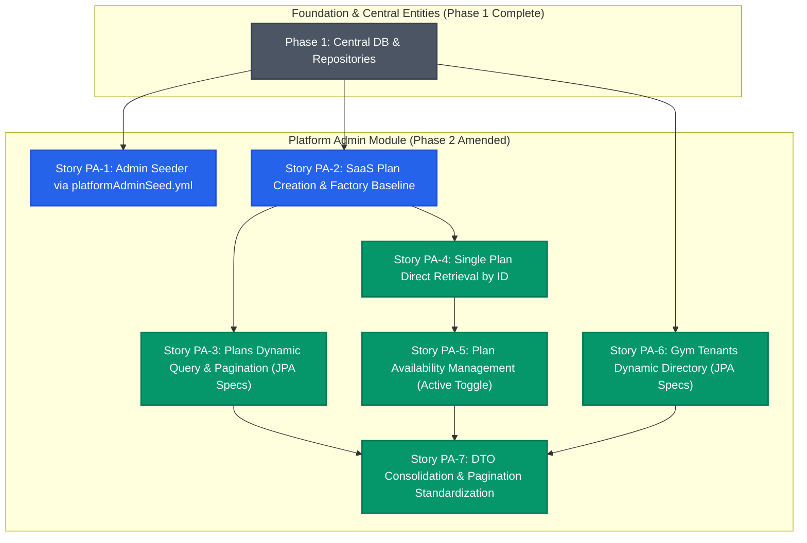

# Platform Admin Module: Dependency Matrix & Implementation Ordering (Amended)

This document establishes the dependency relationships, critical path, risk analysis, and recommended execution sequence for the **Platform Admin Module** of `GymVerse-Backend-v2`, amended for `platformAdminSeed.yml` seeder configuration and JPA Specifications fetch services.

---

## 1. Story Dependency Matrix

| Story ID | Story Title | Immediate Dependencies | Cross-Cutting Dependencies | Blocks / Enables |
| :--- | :--- | :--- | :--- | :--- |
| **Story PA-1** | Initial Platform Administrator Provisioning Engine (YAML-Configured via `platformAdminSeed.yml`) | None | `CentralJpaConfig`, `UserAccountRepository`, `SecurityCryptoConfig`, `PlatformAdminSeedProperties`, `platformAdminSeed.yml` | Administrative login (future auth phase) |
| **Story PA-2** | SaaS Subscription Plan Creation | None | `CentralJpaConfig`, `SaasSubscriptionPlanRepository`, `GlobalExceptionHandler`, `CreateSaasPlanFactory` | Stories PA-3, PA-4, PA-5; Gym registration (future phase) |
| **Story PA-3** | SaaS Subscription Plans Dynamic Query & Catalog Retrieval | Story PA-2 | `SaasSubscriptionPlanRepository` extending `JpaSpecificationExecutor`, `SaasPlanSpecification`, `PagedResponse` | Dynamic catalog filtering & pagination |
| **Story PA-4** | Single SaaS Subscription Plan Retrieval by Identifier | Story PA-2 | `SaasSubscriptionPlanRepository`, `ResourceNotFoundException`, `SaasPlanMapper` | Story PA-5 (plan lookup verification) |
| **Story PA-5** | SaaS Subscription Plan Availability Management | Stories PA-2, PA-4 | `SaasSubscriptionPlanRepository`, `PlatformAdminValidations`, `SaasPlanMapper` | Tenant plan catalog filtering (`findByActiveTrue()`) |
| **Story PA-6** | Platform Registered Gym Tenants Dynamic Directory Retrieval | None (Independent) | `GymTenantRepository` extending `JpaSpecificationExecutor`, `GymTenantSpecification`, `PagedResponse` | Platform operational oversight & future gym suspension |
| **Story PA-7** | Platform Admin Request DTO Consolidation and Pagination Standardization | Stories PA-2, PA-3, PA-4, PA-5, PA-6 | `PlatformAdminRequest`, `SaasPlanFilterRequest`, `GymTenantFilterRequest`, `PlatformAdminValidationsImpl` | Clean, standardized API contract; elimination of precedence ambiguities |

---

## 2. Dependency Graph & Critical Path

---

## 3. Recommended Implementation Sequence

To minimize integration churn and maximize testability, the stories should be implemented in the following strict order:

### **Step 1: Story PA-1 — Initial Platform Administrator Provisioning Engine (YAML-Configured via `platformAdminSeed.yml`)**
- **Rationale:** Establishes `src/main/resources/platformAdminSeed.yml`, imports it into `application.yaml`, binds properties via `PlatformAdminSeedProperties`, provides `PasswordEncoder` (`BCryptPasswordEncoder`) in `config/SecurityCryptoConfig.java`, and enhances `UserAccountRepository`. Proves that external YAML properties bind cleanly, passwords are read from `${PLATFORM_ADMIN_PASSWORD}` without default fallbacks, startup is idempotent with zero password resets, and pre-existing non-admin accounts are protected from silent promotion.
- **Verification Gate:** `PlatformAdminSeedPropertiesTest` and `PlatformAdminProvisioningIntegrationTest` confirm that `platformAdminSeed.yml` is read via Spring Boot configuration import, credentials are encrypted with BCrypt, restarts are idempotent, and non-admin conflicts abort cleanly.

### **Step 2: Story PA-2 — SaaS Subscription Plan Creation & Factory Ingress**
- **Rationale:** Establishes the core module scaffolding:
  - Package structure `com.company.GymVerse.platformAdmin/{controller, factory, service, request, response, validations, mapper}`.
  - Centralized exception hierarchy (`exceptions/` with `BadRequestException`, `ConflictException`, `GlobalExceptionHandler`, and `ErrorResponse`).
  - Base DTO `CreateSaasPlanResponse` and mapper `SaasPlanMapper`.
  - Dispatches plan creation via concrete `CreateSaasPlanFactory`.
- **Verification Gate:** `CreateSaasPlanIntegrationTest` confirms plan creation with exact `BigDecimal` price and duplicate name rejection.

### **Step 3: Story PA-4 — Single SaaS Subscription Plan Retrieval by Identifier**
- **Rationale:** Introduces `ResourceNotFoundException` into `exceptions/` and verifies that individual entity lookup by ID functions with clean HTTP 404 responses. Retains direct single-resource retrieval semantics without forcing pagination. Having lookup-by-ID ready is a direct prerequisite for Story PA-5.
- **Verification Gate:** `GetSaasPlanByIdIntegrationTest` verifies HTTP 200 for valid ID and HTTP 404 for missing ID.

### **Step 4: Story PA-5 — SaaS Subscription Plan Availability Management**
- **Rationale:** Implements concrete `UpdatePlanAvailabilityFactory` and leverages the lookup logic from PA-4. Enforces the critical invariant that availability toggling strictly mutates `active` while leaving `price` and capacity limits immutable.
- **Verification Gate:** `UpdatePlanAvailabilityIntegrationTest` confirms that deactivating/activating a plan modifies only the `active` flag in MySQL while all other fields remain unchanged.

### **Step 5: Story PA-3 — SaaS Subscription Plans Dynamic Query & Catalog Retrieval**
- **Rationale:** Updates `SaasSubscriptionPlanRepository` to extend `JpaSpecificationExecutor<SaasSubscriptionPlan>`. Introduces `PagedResponse<T>`, `SaasPlanSpecification`, and sort whitelisting in `PlatformAdminValidations`. Having PA-2 and PA-5 complete beforehand allows testing that both active and deactivated plans can be filtered and sorted.
- **Verification Gate:** `GetAllSaasPlansIntegrationTest` verifies dynamic filter combinations, sorting by whitelisted fields, pagination boundaries, and invalid parameter rejection (HTTP 400).

### **Step 6: Story PA-6 — Platform Registered Gym Tenants Dynamic Directory Retrieval**
- **Rationale:** Updates `GymTenantRepository` to extend `JpaSpecificationExecutor<GymTenant>`. Introduces `GymTenantSpecification` and `GymTenantSummaryMapper`. Operates purely against central data without tenant DB routing, returning `PagedResponse<GymTenantSummaryResponse>`.
- **Verification Gate:** `GetGymTenantsIntegrationTest` verifies tenant retrieval, dynamic status/city filtering, sorting, pagination, and zero interaction with `TenantContext`.

### **Step 7: Story PA-7 — Platform Admin Request DTO Consolidation and Pagination Standardization**
- **Rationale:** Consolidates common pagination and sorting at the root of `PlatformAdminRequest`, strips duplicate pagination fields from `SaasPlanFilterRequest` and `GymTenantFilterRequest`, removes flat filter sprawl from `PlatformAdminRequest`, and eliminates dual-path fallback resolution logic across services and validations.
- **Verification Gate:** `PlatformAdminDtoConsolidationIntegrationTest` and full suite regression test (`mvn test`) verify that all 61+ tests pass with canonical single-source DTO reading.

---

## 4. Risk Analysis & Mitigations

| Risk | Impact | Likelihood | Mitigation Strategy |
| :--- | :--- | :--- | :--- |
| **Accidental Modification of Protected Multitenancy Classes** | Critical | Low | Explicit guard in all story acceptance criteria requiring byte-for-byte check of the 8 classes in `com.company.GymVerse.multitanancy`. |
| **Secret Exposure in Version Control** | Critical | Low | Seed configuration resides in `platformAdminSeed.yml` with placeholder `${PLATFORM_ADMIN_PASSWORD}` possessing NO default fallback. Git commits with plaintext passwords are strictly forbidden. |
| **Unauthorized Privilege Escalation via Seeder** | Critical | Low | Story PA-1 safe-conflict policy detects if seed email belongs to an existing non-admin user and throws `IllegalStateException` rather than silently promoting the account. |
| **Accidental Password Reset on Restart** | High | Low | Seeder explicitly checks if an admin exists and skips credential updates, preserving existing administrator passwords. |
| **Property Path Injection via Client Sort Strings** | High | Medium | Strict whitelist validation in `PlatformAdminValidations` for both plans and tenants. Invalid fields throw `BadRequestException`. |
| **Database Performance Degradation on Unbounded Queries** | High | Low | JPA Specifications execute dynamically in MySQL via indexed columns. Pagination parameters are validated with a hard cap `size <= 100`. |
| **Tenant Database Leakage During Central Operations** | Critical | Low | All platform admin services execute strictly under `@Transactional("centralTransactionManager")`. `TenantContext` is neither populated nor accessed. |
