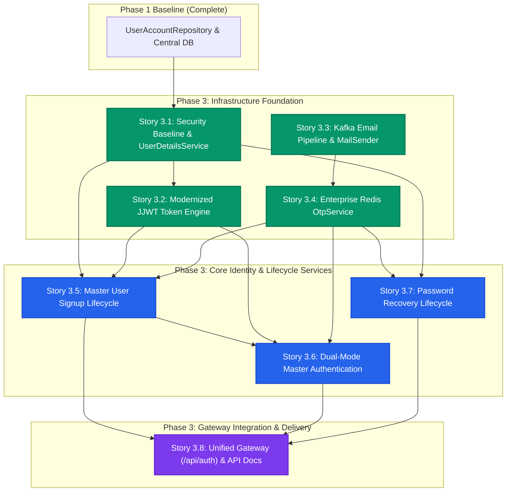

# Phase 3: Core Security & Master DB Authentication — Dependency Matrix & Implementation Ordering

This document establishes the dependency relationships, critical path, risk analysis, and recommended execution sequence for **Phase 3: Core Security Baseline & Master DB Platform Authentication Engine** of `GymVerse-Backend-v2`.

---

## 1. Story Dependency Matrix

| Story ID | Story Title | Immediate Dependencies | Cross-Cutting Dependencies | Blocks / Enables |
| :--- | :--- | :--- | :--- | :--- |
| **Story 3.1** | **Security Baseline & UserDetailsService** | Phase 1 (`UserAccountRepository`) | `SecurityCryptoConfig`, `CentralJpaConfig`, `user_accounts` table | Stories 3.2, 3.5, 3.6 |
| **Story 3.2** | **Modernized JJWT Token Engine** | Story 3.1 | `SecurityConfig`, JJWT 0.12.x, `UserAccount` | Stories 3.5, 3.6, 3.8; All future secured API endpoints |
| **Story 3.3** | **Kafka Asynchronous Email Pipeline & JavaMailSender** | None (Independent infra) | `spring-kafka`, `spring-boot-starter-mail`, `application.yaml` | Story 3.4 (`OtpService` email dispatch) |
| **Story 3.4** | **Enterprise Redis OtpService with Rate Limiting** | Story 3.3 | `RedisConfig`, `KafkaTemplate`, `@ConfigurationProperties` | Stories 3.5, 3.6, 3.7 |
| **Story 3.5** | **Master User Signup Lifecycle** | Stories 3.1, 3.2, 3.4 | `UserAccountRepository`, `PasswordEncoder`, `AuthValidations` | Stories 3.6, 3.8; User population for the entire platform |
| **Story 3.6** | **Dual-Mode Master Authentication Engine** | Stories 3.1, 3.2, 3.4, 3.5 | `AuthenticationManager`, `JwtUtil`, `OtpService` | Stories 3.8; Platform-wide login access |
| **Story 3.7** | **Password Recovery Lifecycle** | Stories 3.1, 3.4 | `UserAccountRepository`, `OtpService`, `PasswordEncoder` | Story 3.8; Self-service account recovery |
| **Story 3.8** | **Unified Security Gateway Integration & API Docs** | Stories 3.1 through 3.7 | `AuthController`, `AuthFactory`, `GlobalExceptionHandler`, `docs/payloads.md` | Phase 3 completion gate; Enables Phase 4 (Tenant Onboarding) |

---

## 2. Dependency Graph & Critical Path

---

## 3. Implementation Sequence & Order of Execution

To guarantee zero compile breaks and progressive verification, execution must strictly follow this linear progression:

### Stage 1: Security & Messaging Infrastructure (Stories 3.1 – 3.4)
1. **Story 3.1**: Establish `SecurityConfig`, `CustomUserDetailsService`, and `AuthenticationManager`.
2. **Story 3.2**: Implement JJWT 0.12.x `JwtUtil` (`MASTER_ACCOUNT` Access & Refresh tokens) and `JwtFilter`.
3. **Story 3.3**: Configure Spring Boot Kafka auto-configuration, `OtpEmailEvent`, `OtpEmailListener`, and `EmailServiceImpl`.
4. **Story 3.4**: Build `OtpService` + `OtpServiceImpl` with Redis cooldown rate limiting (60s), attempt throttling (5 attempts), and state verification flags.

### Stage 2: Business Logic & Lifecycle Operations (Stories 3.5 – 3.7)
5. **Story 3.5**: Implement the 3-step Signup flow (`SIGNUP_INITIATE`, `SIGNUP_VERIFY`, `SIGNUP_COMPLETE`).
6. **Story 3.6**: Implement Dual Login (`LOGIN_PASSWORD`, `LOGIN_OTP_INITIATE`, `LOGIN_OTP_VERIFY`) and `REFRESH_TOKEN`.
7. **Story 3.7**: Implement Password Recovery (`FORGOT_PASSWORD_INITIATE`, `FORGOT_PASSWORD_VERIFY`, `FORGOT_PASSWORD_RESET`).

### Stage 3: Unified Gateway Integration & Documentation (Story 3.8)
8. **Story 3.8**: Assemble the single unified gateway controller `@PostMapping("/api/auth")` with `AuthFactory`, configure `GlobalExceptionHandler` security mappings, publish full contracts to `docs/payloads.md`, and execute the entire test regression suite.
