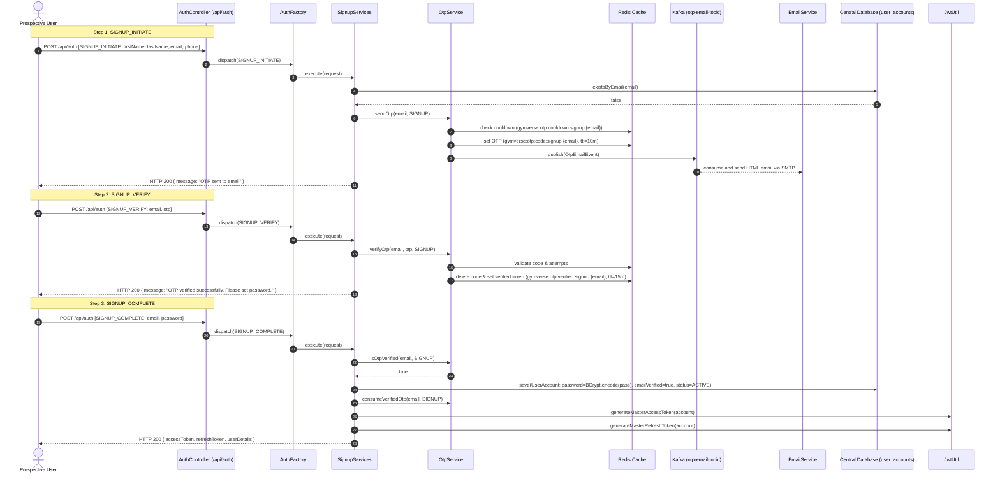
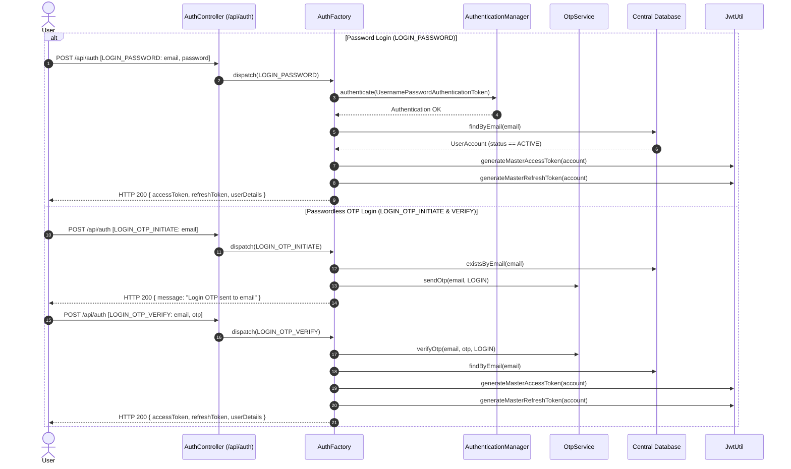

# Epic: Phase 3 — Core Security Baseline & Master DB Platform Authentication Engine

## 1. Executive Summary & Business Objectives

With **Phase 1 (Database Persistence & Multi-Tenancy Baseline)** and **Phase 2 (Platform Admin Governance)** fully completed and verified across 69 passing integration tests, `GymVerse-Backend-v2` now requires its primary security barrier and unified identity gateway.

Every user interacting with the GymVerse ecosystem—whether a Platform Super-Administrator, a Gym Franchise Owner, a Gym Manager/Trainer, or an individual Gym Member—originates at the **Top-Layer Master Database Identity** (`UserAccount` entity in the central `GymVerse` database). 

Phase 3 establishes:
1. **The Core Security Baseline**: A stateless Spring Security filter chain, BCrypt cryptography, central `UserDetailsService`, and modernized JJWT 0.12.x token engine supporting **Master Account Tokens** (Access and Refresh tokens).
2. **Asynchronous Notification Pipeline**: An event-driven Kafka messaging architecture configured strictly via Spring Boot auto-configuration (`application.yaml`) that offloads email delivery (`JavaMailSender`) onto background Kafka listeners.
3. **Enterprise OTP Engine**: A dedicated, rate-limited Redis-backed `OtpService` managing OTP generation, resend cooldowns, maximum verification attempts, and state verification tokens with configuration externalized to YAML.
4. **Unified Top-Layer Master User Lifecycle**: A strictly consolidated `@PostMapping("/api/auth")` single-controller gateway utilizing the Factory Pattern to deliver:
   - **Signup Flow**: Intake (Name, Email, Phone) ➔ Email OTP Verification ➔ Password Creation ➔ Central `UserAccount` Persistence & Token Issuance.
   - **Dual-Mode Login**: Standard Email + Password authentication OR Passwordless Email + OTP login.
   - **Password Recovery**: Self-service Forgot Password flow with Email OTP verification.
   - **Token Refresh**: Seamless session extension via Refresh Token exchange.

---

## 2. In-Depth Reference Project Analysis (`D:\projects\GymVerse-Backend`) vs. v2 Modernization

A detailed audit of the legacy reference implementation (`D:\projects\GymVerse-Backend\4Unknown\`) reveals crucial design patterns and key modernization requirements:

| Architectural Component | Reference Project (`GymVerse-Backend`) | Modernization in `GymVerse-Backend-v2` |
| :--- | :--- | :--- |
| **JWT Token Modeling** | Uses `PLATFORM` token type hardcoded; extracts tenant claims conditionally; raw string parsing. | Eliminates `PLATFORM` naming; implements **`MASTER_ACCOUNT`** token type for top-layer identity. Structured claims: `subject` (userId), `tokenType` (`MASTER_ACCOUNT`), `type` (`ACCESS` / `REFRESH`), and authorities (`ROLE_PLATFORM_ADMIN` or `ROLE_USER_ACCOUNT`). Refresh tokens strictly barred from invoking protected APIs. |
| **Security Filter & Context** | `JwtFilter` manually inspects URI prefixes (`/member`), extracts `TenantContext`, and catches exceptions inline. | Clean separation: `JwtFilter` processes Bearer tokens, validates `MASTER_ACCOUNT` signatures, sets `SecurityContextHolder`, and guards API endpoints from Refresh Token misuse. Tenant-specific context routing remains isolated from central platform auth. |
| **Controller Gateway Architecture** | Exposes multiple endpoints (`/platform-auth`, `/register`), violating single-controller rules. | Strictly adheres to `RULES.md` Rule 4 & `PROMPT.md`: **strictly ONE controller endpoint** `@PostMapping("/api/auth")` driven by `AuthRequestType` discriminator enum and dispatched via `AuthFactory`. |
| **Kafka Configuration & Setup** | Custom `KafkaConfig.java` was manual and ultimately commented out; reliance on raw templates. | **No manual `@Bean ProducerFactory` / `@Bean KafkaTemplate` boilerplate**. Leverages Spring Boot's built-in Kafka auto-configuration driven 100% by `application.yaml` (`spring.kafka.*`). Injects standard `KafkaTemplate<String, Object>`. |
| **Email Dispatch Architecture** | Directly invokes `SendEmailService` or passes `SendOtpEvent` to `OtpListener` with raw HTML template. | Clean event-driven pattern: Operation services never touch mail senders directly. They publish `OtpEmailEvent` to Kafka. Dedicated `OtpEmailListener` consumes event and delegates to `EmailService` with responsive, styled HTML template. |
| **OTP Generation & State Management** | Generated inline inside `SendOtpService` using `ThreadLocalRandom`; stored directly in Redis with raw string keys; no rate limiting or resend cooldown; no attempt limits. | Dedicated, enterprise-grade `OtpService` domain component. Implements cryptographic random generation, configurable TTL, **resend cooldown rate limiting** (e.g. 60s cooldown), **max verification attempt throttling** (e.g. 5 attempts), and clean Redis key namespaces bound to `@ConfigurationProperties(prefix = "gymverse.otp")`. |
| **UserDetailsService & Password Verification** | Custom `CustomUserDetailsService` querying `AccountRepository`. | `CustomUserDetailsService` querying central `UserAccountRepository`, returning Spring Security `UserDetails` with BCrypt password verification and account status validation (`ACTIVE` vs `PENDING` vs `SUSPENDED`). |

---

## 3. Invariants & Scope Boundaries

### 3.1 In Scope

1. **Security Infrastructure & Cryptography**:
   - Stateless `SecurityFilterChain` permitting `/api/auth` while authenticating all protected platform endpoints.
   - BCrypt `PasswordEncoder` and `AuthenticationManager` configuration.
   - Central `CustomUserDetailsService` loading `UserAccount` entities from central DB.
2. **Modernized JJWT Token Engine**:
   - `JwtUtil` built on JJWT 0.12.5 / 0.12.6 API (`Jwts.builder()`, `Jwts.parser().verifyWith(key)`).
   - Generates and validates `MASTER_ACCOUNT` Access Tokens (15 min default) and Refresh Tokens (30 days default).
   - `JwtFilter` validating headers, preventing Refresh Token API execution, and establishing `SecurityContext`.
3. **Kafka Asynchronous Messaging**:
   - Auto-configured Kafka producer via `application.yaml`.
   - Strongly-typed `OtpEmailEvent` message model.
   - `@KafkaListener` topic consumer (`OtpEmailListener`) on topic `otp-email-topic`.
4. **Dedicated Email Service**:
   - `EmailService` utilizing `JavaMailSender` and `MimeMessageHelper`.
   - Beautiful, responsive HTML email template for 6-digit OTP delivery.
5. **Enterprise Redis `OtpService`**:
   - Configurable OTP properties via `@ConfigurationProperties(prefix = "gymverse.otp")`.
   - Rate limiting: resend cooldown guard (prevents spamming).
   - Attempt throttling: max failed verification threshold (prevents brute-force attacks).
   - Verified state token issuance and one-time consumption.
6. **Unified Auth Controller & Factory**:
   - Single gateway: `@PostMapping("/api/auth")`.
   - Factory pattern: `AuthFactory` dispatching to `AuthOperation` beans.
   - Supported Operations:
     - `SIGNUP_INITIATE`: Validates profile uniqueness, triggers OTP dispatch.
     - `SIGNUP_VERIFY`: Verifies OTP code, generates verified session in Redis.
     - `SIGNUP_COMPLETE`: Verifies state, sets BCrypt password, creates active `UserAccount`, returns tokens.
     - `LOGIN_PASSWORD`: Verifies credentials via `AuthenticationManager`, returns tokens.
     - `LOGIN_OTP_INITIATE`: Triggers OTP dispatch for passwordless login.
     - `LOGIN_OTP_VERIFY`: Verifies OTP, loads account, returns tokens.
     - `FORGOT_PASSWORD_INITIATE`: Triggers password reset OTP dispatch.
     - `FORGOT_PASSWORD_VERIFY`: Verifies reset OTP, generates password reset state in Redis.
     - `FORGOT_PASSWORD_RESET`: Updates password in central DB, consumes reset state.
     - `REFRESH_TOKEN`: Exchanges valid refresh token for new access token.
7. **Handwritten Mappers & Validations**:
   - `AuthMapper` + `AuthMapperImpl` (zero MapStruct or reflection).
   - `AuthValidations` + `AuthValidationsImpl` (strict email regex, phone formatting, password complexity).
8. **Protected Multitenancy Isolation**:
   - All 8 classes in `com.company.GymVerse.multitanancy` remain **100% byte-for-byte untouched**.

### 3.2 Explicitly Out of Scope

1. **Gym Tenant Physical Database Provisioning**: Creating new MySQL databases (`gymverse_tenant_<gym_code>`) and executing dynamic tenant Flyway migrations is deferred to Phase 4 (Tenant Onboarding).
2. **Gym Registration Operation (`REGISTER_GYM`)**: Registering a physical gym entity (`gym_tenants`) and assigning tenant ownership belongs to Phase 4.
3. **Tenant Local Database Operations**: Local member records, trainer permissions, and tenant-scoped auth belong to Phase 4 & Phase 5.
4. **Social OAuth2 (Google / Apple)**: Third-party federated identity is reserved for a future enhancement epic.

---

## 4. System Architecture & Component Interactions

### 4.1 Component Architecture & Layering

```
               HTTP POST /api/auth (AuthRequest)
                              │
                              ▼
                ┌───────────────────────────┐
                │      AuthController       │
                └─────────────┬─────────────┘
                              │
                              ▼
                ┌───────────────────────────┐
                │        AuthFactory        │
                └─────────────┬─────────────┘
                              │
         ┌────────────────────┼────────────────────┐
         │                    │                    │
         ▼                    ▼                    ▼
┌──────────────────┐ ┌──────────────────┐ ┌──────────────────┐
│ SignupOperations │ │ LoginOperations  │ │ ForgotPasswordOp │
└────────┬─────────┘ └────────┬─────────┘ └────────┬─────────┘
         │                    │                    │
         ├────────────────────┴────────────────────┤
         │                                         │
         ▼                                         ▼
┌──────────────────┐                      ┌──────────────────┐
│    OtpService    │                      │  UserAccountRepo │
└────────┬─────────┘                      └────────┬─────────┘
         │                                         │
    ┌────┴────────────────────────┐                ▼
    ▼                             ▼          ┌───────────┐
┌───────┐                  ┌─────────────┐   │ Central DB│
│ Redis │                  │KafkaTemplate│   │(user_accs)│
└───────┘                  └──────┬──────┘   └───────────┘
                                  │
                                  ▼ (otp-email-topic)
                           ┌─────────────┐
                           │ OtpListener │
                           └──────┬──────┘
                                  │
                                  ▼
                           ┌─────────────┐
                           │EmailService │ ──> JavaMailSender (SMTP)
                           └─────────────┘
```

---

### 4.2 Sequence Flows

#### Flow 1: Top-Layer Signup Lifecycle


---

#### Flow 2: Dual Login Lifecycle (Password & OTP)


---

## 5. Directory Layout & Prescribed Package Structure

All Phase 3 classes will strictly reside within their modular packages following `PROMPT.md` Section 2:

```
src/main/java/com/company/GymVerse/
│
├── security/                               # Core Security & Token Engine
│   ├── jwt/
│   │   ├── JwtUtil.java                    # JJWT 0.12.x Master Token generation & extraction
│   │   ├── JwtFilter.java                  # OncePerRequestFilter parsing Master Account Bearer tokens
│   │   └── CustomUserDetailsService.java   # UserDetailsService backed by UserAccountRepository
│   ├── SecurityConfig.java                 # SecurityFilterChain, CORS, stateless session, public /api/auth
│   └── SecurityCryptoConfig.java           # BCrypt password encoder bean
│
├── otp/                                    # Enterprise Redis OTP Domain Service
│   ├── config/
│   │   └── OtpConfigProperties.java        # @ConfigurationProperties(prefix = "gymverse.otp")
│   ├── service/
│   │   └── OtpService.java                 # OTP domain contract
│   ├── serviceImpl/
│   │   └── OtpServiceImpl.java             # Cooldown rate limiting, attempts throttling, Redis ops
│   └── util/
│       └── OtpPurpose.java                 # SIGNUP, LOGIN, FORGOT_PASSWORD enum
│
├── exceptions/                             # Centralized Exception Hierarchy & Subdirectories
│   ├── GlobalExceptionHandler.java         # Centralized @RestControllerAdvice error translator
│   ├── ErrorResponse.java                  # Standard error payload contract
│   ├── BadRequestException.java            # Existing base 400 exception
│   ├── ConflictException.java              # Existing base 409 exception
│   ├── ResourceNotFoundException.java      # Existing base 404 exception
│   ├── otp/                                # OTP-specific exception subpackage
│   │   ├── OtpExpiredException.java        # Specific OTP expired exception (HTTP 400)
│   │   ├── OtpInvalidException.java        # Specific OTP invalid exception (HTTP 400)
│   │   └── OtpRateLimitException.java      # Specific resend cooldown violation (HTTP 429)
│   └── auth/                               # Auth-specific exception subpackage
│       └── InvalidTokenException.java      # Specific token validation exception (HTTP 401)
│
├── messaging/                              # Asynchronous Messaging (Kafka)
│   ├── kafka/
│   │   ├── events/
│   │   │   └── OtpEmailEvent.java          # Event payload (email, otp, purpose, timestamp)
│   │   └── listeners/
│   │       └── OtpEmailListener.java       # @KafkaListener consumer on "otp-email-topic"
│
├── email/                                  # Asynchronous Email Delivery
│   ├── service/
│   │   └── EmailService.java               # Mail sender interface
│   ├── serviceImpl/
│   │   └── EmailServiceImpl.java           # JavaMailSender implementation with styled HTML template
│
└── auth/                                   # Unified Feature Module: Platform Master Auth
    ├── controller/
    │   └── AuthController.java             # Unified Gateway: @PostMapping("/api/auth")
    ├── factory/
    │   ├── AuthFactory.java                # Operation resolver / dispatcher
    │   └── AuthOperation.java              # Operation interface contract
    ├── service/
    │   ├── SignupInitiateService.java      # Handles SIGNUP_INITIATE
    │   ├── SignupVerifyService.java        # Handles SIGNUP_VERIFY
    │   ├── SignupCompleteService.java      # Handles SIGNUP_COMPLETE
    │   ├── LoginPasswordService.java       # Handles LOGIN_PASSWORD
    │   ├── LoginOtpInitiateService.java    # Handles LOGIN_OTP_INITIATE
    │   ├── LoginOtpVerifyService.java      # Handles LOGIN_OTP_VERIFY
    │   ├── ForgotPasswordInitiateService.java # Handles FORGOT_PASSWORD_INITIATE
    │   ├── ForgotPasswordVerifyService.java   # Handles FORGOT_PASSWORD_VERIFY
    │   ├── ForgotPasswordResetService.java    # Handles FORGOT_PASSWORD_RESET
    │   └── RefreshTokenService.java        # Handles REFRESH_TOKEN
    ├── request/
    │   ├── AuthRequest.java                # Unified request envelope with discriminator
    │   ├── SignupRequest.java              # Nested DTO for signup data
    │   ├── LoginRequest.java               # Nested DTO for password/otp credentials
    │   ├── ForgotPasswordRequest.java      # Nested DTO for password recovery
    │   └── enums/
    │       └── AuthRequestType.java        # Discriminator enum (10 distinct operations)
    ├── response/
    │   ├── AuthResponse.java               # Unified response envelope
    │   └── UserSummaryResponse.java        # User profile view DTO
    ├── validations/
    │   ├── AuthValidations.java            # Validation contract
    │   └── AuthValidationsImpl.java        # Email format, password strength, profile constraints
    └── mapper/
        ├── AuthMapper.java                 # Entity <-> DTO mapper interface
        └── AuthMapperImpl.java             # Handwritten mapping implementation
```

---

## 6. Story Breakdown & Implementation Roadmap

Once this Epic is approved, it will be divided into the following 8 actionable, self-contained stories:

| Story ID | Story Title | Core Focus & Artifacts | Primary Verification |
| :--- | :--- | :--- | :--- |
| **Story 3.1** | **Security Baseline & UserDetailsService** | `SecurityConfig`, `CustomUserDetailsService`, `AuthenticationManager` bean, BCrypt verification against central `UserAccountRepository`. | Unit tests for UserDetailsService; Spring context boot verification. |
| **Story 3.2** | **Modernized JJWT Token Engine** | `JwtUtil` (JJWT 0.12.x), `JwtFilter` with `MASTER_ACCOUNT` typing, Access/Refresh expiration handling, rejection of Refresh Token on API access. | Unit tests for token generation, expiration, tampering, claim extraction, filter chaining. |
| **Story 3.3** | **Kafka Email Event Pipeline & JavaMailSender** | `OtpEmailEvent`, `OtpEmailListener`, `EmailService` with HTML template, Spring Boot Kafka auto-config in `application.yaml`. | Kafka consumer integration test verifying event receipt and mail dispatch. |
| **Story 3.4** | **Enterprise Redis OtpService with Rate Limiting** | `OtpService`, `OtpServiceImpl`, `OtpConfigProperties`, cooldown guard (60s), attempt counter (max 5), state verification tokens. | Redis integration tests verifying cooldown, expiration, failed attempt lockout, verification tokens. |
| **Story 3.5** | **Master User Signup Lifecycle** | `SIGNUP_INITIATE`, `SIGNUP_VERIFY`, `SIGNUP_COMPLETE` services, `AuthValidations`, password complexity checks, central DB persistence. | End-to-end integration test of 3-step signup flow resulting in active `UserAccount` and tokens. |
| **Story 3.6** | **Dual-Mode Master Authentication Engine** | `LOGIN_PASSWORD`, `LOGIN_OTP_INITIATE`, `LOGIN_OTP_VERIFY`, `REFRESH_TOKEN` services, token refresh rotation. | Integration tests for password login, passwordless OTP login, invalid credentials, and refresh exchange. |
| **Story 3.7** | **Password Recovery Lifecycle** | `FORGOT_PASSWORD_INITIATE`, `FORGOT_PASSWORD_VERIFY`, `FORGOT_PASSWORD_RESET` services, password update, reset token consumption. | Integration test of complete forgot-password flow and subsequent login with updated password. |
| **Story 3.8** | **Unified Security Gateway Integration & API Docs** | Unified `AuthController` (`/api/auth`), `AuthFactory`, error handling in `GlobalExceptionHandler`, and complete payload contracts in `docs/payloads.md`. | Full suite integration tests across all 10 operations, cURL contract validation, regression suite check. |

---

## 7. Quality Gates & Non-Negotiable Directives

1. **Git Policy Enforcement (`RULES.md` Rule 1)**:
   - **NO autonomous `git commit` or `git push`**. All changes remain local until explicitly ordered by the user.
2. **Single-Endpoint Gateway (`RULES.md` Rule 4 & `PROMPT.md`)**:
   - Exactly ONE endpoint: `@PostMapping("/api/auth")`. No GET endpoints, no subpaths (`/signup`, `/login`, etc.).
3. **Protected Multitenancy Code**:
   - Zero changes to any class in `com.company.GymVerse.multitanancy`.
4. **Clean Code & Dependencies**:
   - Zero `@Autowired` annotations; constructor injection with `@RequiredArgsConstructor` only.
   - Handwritten mappers only (`AuthMapperImpl`). No MapStruct.
   - Separation of validations into `AuthValidationsImpl`.
5. **Session Continuity**:
   - Update `antigravity/project-context.md` and log every story in `antigravity/<story-name>.md`.
6. **Zero-Trust Security**:
   - Passwords strictly hashed via BCrypt before database storage.
   - Sensitive credentials externalized via environment variables.

---

## 8. Open Decisions & User Alignment

Before breaking this epic into execution stories, please confirm your preferences on:
1. **Master Token Naming**: The epic specifies `MASTER_ACCOUNT` as the token type claim (replacing `PLATFORM`). Does this naming resonate with your vision?
2. **OTP Default Durations**:
   - OTP validity: 10 minutes.
   - Resend cooldown: 60 seconds.
   - Max verification attempts: 5 attempts before invalidation.
   - Verified session state TTL: 15 minutes (time user has to submit password after OTP verification).
3. **Token Validity Durations**:
   - Master Access Token: 15 minutes.
   - Master Refresh Token: 30 days.

---
