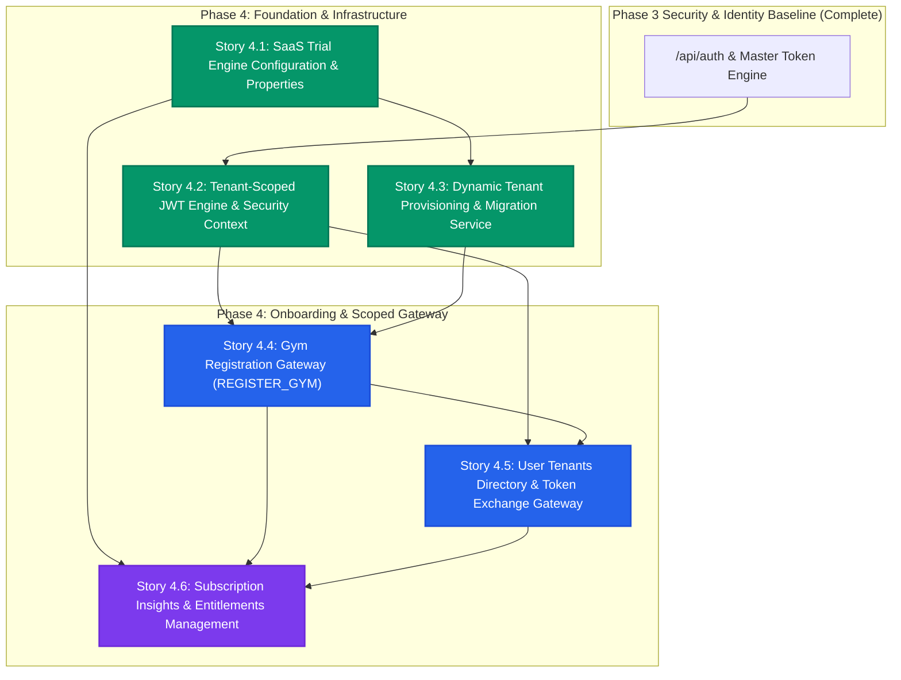

# Phase 4: Tenant Onboarding, Dynamic Provisioning & Scoped RBAC — Dependency Matrix & Implementation Ordering

This document establishes the dependency relationships, critical path, risk analysis, and execution sequence for **Phase 4: Tenant Onboarding, Dynamic Database Provisioning, Scoped RBAC & Subscription Lifecycle** of `GymVerse-Backend-v2`.

---

## 1. Story Dependency Matrix

| Story ID | Story Title | Immediate Dependencies | Cross-Cutting Dependencies | Blocks / Enables |
| :--- | :--- | :--- | :--- | :--- |
| **Story 4.1** | **SaaS Trial Engine Configuration & Properties** | Phase 1 Central Repositories | `application.yaml`, `TenantConfigProperties` | Stories 4.3, 4.4, 4.6 |
| **Story 4.2** | **Tenant-Scoped JWT Engine & Security Context Resolution** | Story 3.2 (`JwtUtil`, `JwtFilter`) | `TenantContext`, `SecurityContextHolder`, `UserTenantRole` | Stories 4.4, 4.5, All tenant-scoped operations |
| **Story 4.3** | **Dynamic Tenant Provisioning & Schema Migration Service** | Story 4.1 | `TenantDatabaseService`, `TenantFlywayService`, `TenantRoutingBridge`, `gym_tenants`, `user_tenant_roles`, tenant `users` | Story 4.4 (Gym Registration Gateway) |
| **Story 4.4** | **Gym Registration Gateway (`REGISTER_GYM`)** | Stories 4.1, 4.2, 4.3 | `TenantAdminController`, `TenantAdminFactory`, `TenantAdminValidations`, `gym_subscriptions` | Stories 4.5, 4.6; Onboards gyms onto the platform |
| **Story 4.5** | **User Tenants Directory (`FETCH_MY_TENANTS`) & Token Exchange (`SWITCH_TENANT`)** | Stories 4.2, 4.4 | `user_tenant_roles`, `AuthController`, `AuthFactory`, `TenantAdminFactory` | Enables users to switch into their registered or joined gyms |
| **Story 4.6** | **Subscription Insights & Entitlements Management** | Stories 4.1, 4.4, 4.5 | `gym_subscriptions`, `saas_subscription_plans`, `docs/payloads.md` | Phase 4 completion gate; Enables Phase 5 (Tenant Operations) |

---

## 2. Dependency Graph & Critical Path

---

## 3. Implementation Sequence & Order of Execution

### Stage 1: Configuration & Security Foundation (Stories 4.1 & 4.2)
1. **Story 4.1**: Create `TenantConfigProperties`, bind `gymverse.saas.trial.*` in `application.yaml`, and build date/trial duration calculation helpers.
2. **Story 4.2**: Extend `JwtUtil` with `generateTenantAccessToken` and `generateTenantRefreshToken`. Enhance `JwtFilter` to parse `TENANT_ACCOUNT` tokens, dynamically set `TenantContext.setCurrentTenant(tenantDbName)`, and register granted authorities (`ROLE_TENANT_ADMIN`, `ROLE_MEMBER`, etc.).

### Stage 2: Dynamic Provisioning Infrastructure (Story 4.3)
3. **Story 4.3**: Implement `TenantProvisioningService` encapsulating physical MySQL database creation (`TenantDatabaseService.createDatabase`), Flyway migration (`TenantFlywayService.migrate`), local user seeding (`TenantRoutingBridge.callInTenantTx`), central records insertion (`gym_tenants`, `user_tenant_roles`), and transactional compensation rollback on failure.

### Stage 3: Unified Tenant Admin Gateway & Onboarding (Story 4.4)
4. **Story 4.4**: Build `TenantAdminController` (`@PostMapping("/api/tenant-admin")`), `TenantAdminFactory`, `TenantAdminValidations` (with `X-Client-Platform` enforcement barring mobile), execute `RegisterGymService`, activate free trial in `gym_subscriptions`, and issue tenant tokens directly in response.

### Stage 4: Directory & Token Switching (Story 4.5)
5. **Story 4.5**: Implement `FETCH_MY_TENANTS` under `/api/tenant-admin` to list all gyms where the caller has any role. Add `SWITCH_TENANT` to `/api/auth` to allow Master Token callers to switch into any authorized gym tenant.

### Stage 5: Subscription Insights & Completion Gate (Story 4.6)
6. **Story 4.6**: Implement `FETCH_TENANT_SUBSCRIPTION` (plan status, trial countdown, feature flags), verify entitlements, document all Phase 4 endpoints in `docs/payloads.md`, and execute the comprehensive integration test suite.
