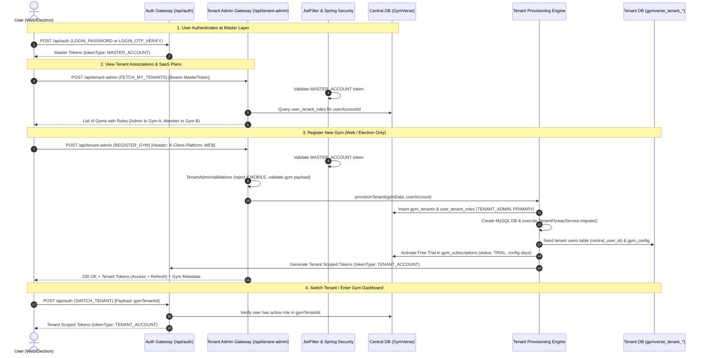

# Epic: Phase 4 — Tenant Onboarding, Dynamic Database Provisioning, Scoped RBAC & Subscription Lifecycle

## 1. Executive Summary & Business Objectives

With **Phase 3 (Core Security & Master DB Authentication Engine)** fully completed, verified, and locked in with 148 passing tests, `GymVerse-Backend-v2` now advances to its primary multi-tenant operational milestone: **Phase 4**.

In the GymVerse two-layer architecture, users register and authenticate at the **Top-Layer Master Database Identity** level (`UserAccount` entity in the central `GymVerse` database). From this master vantage point, a user can:
1. Inspect available platform SaaS subscription plans.
2. View their unified **Tenant Directory** (`FETCH_MY_TENANTS`), displaying all gyms where they hold a role (`ADMIN`, `MEMBER`, `TRAINER`, or `STAFF`).
3. Register a new gym franchise/center to become a **Tenant Administrator** (restricted to Web and Electron desktop platforms; strictly barred on mobile apps).
4. Seamlessly switch into any authorized gym tenant via a **Token Exchange API** (`SWITCH_TENANT`) that trades a Master Token for a scoped **Tenant Access Token** (`tokenType: TENANT_ACCOUNT`) bound to that specific gym's isolated database.
5. Receive an automated **Free Trial** upon registering a gym, driven by an externalized, configurable trial duration (`gymverse.saas.trial.duration-days`).
6. Access a dedicated **Tenant Subscription Page** inside their gym dashboard displaying active plan details, remaining trial days, and feature entitlements (`max_members`, `analytics_enabled`, `custom_branding_enabled`), without cluttering everyday operational workflows.

Phase 4 establishes this entire end-to-end bridge between central master identity and isolated tenant operations while strictly preserving the single-endpoint gateway convention and all 8 protected multitenancy classes.

---

## 2. Reference Implementation Audit (`4Unknown/RegisterGym.java`) vs. GymVerse v2 Modernization

A thorough architectural audit of [`RegisterGym.java`](file:///D:/projects/GymVerse-Backend/4Unknown/src/main/java/com/company/GymVerse/authentication/platformAuthentication/factoryServices/RegisterGym.java) in the legacy repository reveals critical architectural lessons and highlights our modernized v2 design:

| Architectural Dimension | Legacy Implementation (`4Unknown`) | GymVerse v2 Modernization (Phase 4) |
| :--- | :--- | :--- |
| **Module Domain & Responsibility** | Resided inside `authentication.platformAuthentication` under `AuthRequestType.REGISTER_GYM`. Mixed basic user login with heavyweight MySQL database provisioning and Flyway execution. | **Clean Domain Separation**: `RegisterGym` is decoupled from authentication and lives in the **Tenant Admin Module** (`com.company.GymVerse.tenantAdmin`). `/api/auth` remains focused strictly on token lifecycle and identity. |
| **Security & Authorization** | Controller mixed unauthenticated public endpoints with authenticated registration logic without clear boundaries. | **Master Token Protection**: The Tenant Admin gateway `@PostMapping("/api/tenant-admin")` is strictly protected by Spring Security, requiring a valid Master Bearer Token (`tokenType: MASTER_ACCOUNT`). Central caller identity is extracted from `SecurityContextHolder`. |
| **Tenant Database Security Invariant** | Stored the hashed password inside tenant `users` table (`password(account.getPassword())`). Stored duplicate credential data in multiple places. | **Zero Password Invariant**: Per [V1__init_tenant_schema.sql](file:///D:/projects/GymVerse-Backend-v2/src/main/resources/db/migration/tenant/V1__init_tenant_schema.sql), tenant `users` has **zero password fields**. It references the master identity via `central_user_id`. Master credentials never leave the central database. |
| **Multi-Gym Role Association** | Lacked a dedicated relation table to map users across multiple gyms with varied roles. | Persists records in `user_tenant_roles` (`user_account_id`, `gym_tenant_id`, `role: TENANT_ADMIN`, `admin_authority: PRIMARY`, `status: ACTIVE`), enabling users to be an Admin in Gym A, a Member in Gym B, and a Trainer in Gym C. |
| **Client Platform Restriction** | No client differentiation; any mobile client could initiate infrastructure provisioning. | **Enforced Platform Boundary**: Enforces `X-Client-Platform` header validation (`WEB`, `DESKTOP_ELECTRON`, vs `MOBILE`). Registration calls from mobile return `403 Forbidden` (`Gym registration is restricted to Web and Desktop platforms`). |
| **SaaS Free Trial Automation** | No SaaS subscription record was linked upon gym registration. | **Automated Free Trial Engine**: Automatically provisions a `gym_subscriptions` record (`status: TRIAL`, `price_paid: 0.00`, `start_date: today`, `end_date: today + trialDays`) driven by `application.yaml`. |
| **Database Failure Handling** | Basic try-catch with manual drop database. | **Robust Transactional Rollback Engine**: Atomic provisioning wrapped in compensation logic; drops orphan databases on failure, cleans tenant connection caches, and unrolls central database records. |
| **Token Return & Hand-off** | Returned tenant access & refresh tokens upon registration. | Retains and enhances this seamless hand-off: Immediately issues `TENANT_ACCOUNT` tokens containing `tenantId`, `gymCode`, `dbName`, and `role: TENANT_ADMIN` for instant dashboard entry. |

---

## 3. Core Architectural Invariants & Non-Negotiables

All development across Phase 4 must strictly adhere to the following system rules:

1. **Strict Git Commit & Push Policy (`RULES.md` Rule 1)**:
   - **NEVER** run `git commit` or `git push` autonomously.
   - All commits and pushes must only occur when explicitly instructed by the user in chat.

2. **Single-Endpoint Controller Gateway (`RULES.md` Rule 4 & `PROMPT.md`)**:
   - The Tenant Admin module must expose **strictly ONE endpoint**: `@PostMapping("/api/tenant-admin")`.
   - Operations (`REGISTER_GYM`, `FETCH_MY_TENANTS`, `FETCH_TENANT_SUBSCRIPTION`, `EXTEND_SUBSCRIPTION`) are dispatched via `TenantAdminRequestType` discriminator enum through `TenantAdminFactory`.
   - Token exchange (`SWITCH_TENANT`) is dispatched via the authentication gateway `@PostMapping("/api/auth")` under `AuthRequestType.SWITCH_TENANT`.
   - Strictly **NO** ad-hoc controller endpoints, sub-paths, or HTTP GET/PUT/DELETE methods.

3. **Protected Multitenancy Isolation**:
   - All 8 classes in `com.company.GymVerse.multitanancy` remain **100% byte-for-byte untouched**:
     `TenantContext`, `TenantDatabaseService`, `TenantFlywayService`, `TenantDataSourceCache`, `TenantRoutingBridge`, `CentralJpaConfig`, `TenantJpaConfig`, `GymVerseMultiTenantConnectionProvider`, `GymVerseCurrentTenantIdentifierResolver`.
   - Interaction with tenant databases must strictly use `TenantRoutingBridge.callInTenantTx(dbName, ...)` or standard tenant repository operations within an active `TenantContext`.

4. **Handwritten Mappers & Dedicated Validations**:
   - Strictly handwritten mappers (`TenantAdminMapper` + `TenantAdminMapperImpl`). No MapStruct or reflection.
   - Dedicated validation layer (`TenantAdminValidations` + `TenantAdminValidationsImpl`).

5. **Token Type Segregation**:
   - Master Tokens: `tokenType: "MASTER_ACCOUNT"` (access to central `/api/tenant-admin`, plan catalogs, tenant directory).
   - Tenant Tokens: `tokenType: "TENANT_ACCOUNT"` (access to tenant-scoped operations; carries `tenantId`, `gymCode`, `dbName`, `role`, `adminAuthority`).
   - `JwtFilter` parses `TENANT_ACCOUNT` claims, sets `TenantContext.setCurrentTenant(dbName)`, and populates `SecurityContext`.

---

## 4. End-to-End User Journey & Interaction Architecture

### 4.1 System Interaction Sequence Diagram



---

## 5. Module Structure & Component Architecture

### 5.1 Package Hierarchy (`com.company.GymVerse.tenantAdmin`)

```
src/main/java/com/company/GymVerse/tenantAdmin/
├── config/
│   └── TenantConfigProperties.java         # Externalized properties (trial days, default plan id)
├── controller/
│   └── TenantAdminController.java          # Single @PostMapping("/api/tenant-admin")
├── factory/
│   ├── TenantAdminFactory.java             # Spring Map-based bean lookup
│   └── TenantAdminOperation.java           # Contract interface for operations
├── request/
│   ├── TenantAdminRequest.java             # Shared master request envelope
│   ├── RegisterGymRequest.java             # Gym registration payload (name, address, coordinates, hours)
│   ├── FetchMyTenantsRequest.java          # Pagination / filtering parameters
│   ├── FetchTenantSubscriptionRequest.java # Tenant subscription query parameters
│   └── enums/
│       └── TenantAdminRequestType.java     # REGISTER_GYM, FETCH_MY_TENANTS, FETCH_TENANT_SUBSCRIPTION, EXTEND_SUBSCRIPTION
├── response/
│   ├── TenantAdminResponse.java            # Shared master response envelope
│   ├── RegisterGymResponse.java            # Provisioning details + tenant tokens
│   ├── UserTenantSummaryResponse.java      # Single gym association item
│   ├── FetchMyTenantsResponse.java         # Paginated tenant associations list
│   └── TenantSubscriptionDetailsResponse.java # Plan name, trial days remaining, entitlements
├── mapper/
│   ├── TenantAdminMapper.java              # Handwritten mapping interface
│   └── TenantAdminMapperImpl.java          # DTO conversion implementations
├── validations/
│   ├── TenantAdminValidations.java         # Validation interface
│   └── TenantAdminValidationsImpl.java     # Platform header check, uniqueness, coordinates
└── service/
    ├── TenantProvisioningService.java      # Orchestrates DB creation, Flyway, seed, rollback
    ├── RegisterGymService.java             # Implements TenantAdminOperation (REGISTER_GYM)
    ├── FetchMyTenantsService.java          # Implements TenantAdminOperation (FETCH_MY_TENANTS)
    ├── FetchTenantSubscriptionService.java # Implements TenantAdminOperation (FETCH_TENANT_SUBSCRIPTION)
    └── ExtendTenantSubscriptionService.java# Implements TenantAdminOperation (EXTEND_SUBSCRIPTION)
```

### 5.2 Auth Module Extensions (`com.company.GymVerse.auth`)
To support the token exchange lifecycle:
* `AuthRequestType.SWITCH_TENANT`: Operation accepting `gymTenantId` / `gymCode`, validating caller membership, and issuing `TENANT_ACCOUNT` tokens.
* `SwitchTenantService`: Implements `AuthOperation` for `SWITCH_TENANT`.
* `SwitchTenantRequest`: Carries `Long gymTenantId`.

---

## 6. Phased Story Breakdown & Implementation Roadmap

```
┌────────────────────────────────────────────────────────────────────────┐
│ STORY 4.1: SaaS Trial Engine Configuration & Properties                │
│ - Externalize trial settings to application.yaml (trial days, plan)    │
│ - TenantConfigProperties bean with validation defaults                │
│ - Trial calculation and date expiration utilities                      │
└───────────────────────────────────┬────────────────────────────────────┘
                                    │
                                    ▼
┌────────────────────────────────────────────────────────────────────────┐
│ STORY 4.2: Tenant-Scoped JWT Engine & Security Context Resolution      │
│ - Update JwtUtil for TENANT_ACCOUNT token generation & parsing         │
│ - Include claims: tenantId, gymCode, dbName, role, adminAuthority      │
│ - Enhance JwtFilter to bind TenantContext & populate authorities       │
└───────────────────────────────────┬────────────────────────────────────┘
                                    │
                                    ▼
┌────────────────────────────────────────────────────────────────────────┐
│ STORY 4.3: Dynamic Tenant Provisioning & Schema Migration Service      │
│ - TenantProvisioningService with safe compensation / rollback guard    │
│ - TenantDatabaseService & TenantFlywayService orchestration            │
│ - Tenant local users profile & gym_config seeding (Zero passwords)     │
│ - Central gym_tenants & user_tenant_roles persistence                  │
└───────────────────────────────────┬────────────────────────────────────┘
                                    │
                                    ▼
┌────────────────────────────────────────────────────────────────────────┐
│ STORY 4.4: Gym Registration Gateway (REGISTER_GYM)                     │
│ - Single-endpoint gateway: @PostMapping("/api/tenant-admin")           │
│ - TenantAdminValidations with X-Client-Platform restriction (reject    │
│   MOBILE with 403 Forbidden; permit WEB / DESKTOP_ELECTRON)           │
│ - Free trial activation in gym_subscriptions (status: TRIAL)           │
│ - Immediate issuance and return of TENANT_ACCOUNT tokens               │
└───────────────────────────────────┬────────────────────────────────────┘
                                    │
                                    ▼
┌────────────────────────────────────────────────────────────────────────┐
│ STORY 4.5: User Tenants Directory & Token Exchange Gateway             │
│ - FETCH_MY_TENANTS operation (list gyms where user is Admin or Member) │
│ - SWITCH_TENANT operation in /api/auth (exchange Master for Tenant)    │
│ - Verification of active status and role in user_tenant_roles          │
└───────────────────────────────────┬────────────────────────────────────┘
                                    │
                                    ▼
┌────────────────────────────────────────────────────────────────────────┐
│ STORY 4.6: Subscription Insights & Entitlements Management             │
│ - FETCH_TENANT_SUBSCRIPTION operation (active plan, trial countdown)   │
│ - Feature entitlements verification (max_members, analytics_enabled)   │
│ - EXTEND_SUBSCRIPTION operation placeholder for SaaS payment flow      │
│ - Full integration test suite & docs/payloads.md documentation update  │
└────────────────────────────────────────────────────────────────────────┘
```

### Story Details

#### Story 4.1: SaaS Trial Engine Configuration & Properties
* **Objective:** Establish externalized configuration for SaaS trial periods and default trial plan mapping.
* **Target Artifacts:** `TenantConfigProperties.java`, `application.yaml` (`gymverse.saas.trial.duration-days`, `gymverse.saas.trial.default-plan-id`), `SubscriptionDateUtil.java`.
* **Testing:** Configuration binding tests and trial end-date computation unit tests.

#### Story 4.2: Tenant-Scoped JWT Engine & Security Context Resolution
* **Objective:** Equip `JwtUtil` and `JwtFilter` to generate, validate, and extract tenant-scoped JWT tokens (`TENANT_ACCOUNT`) with zero thread-local leaks.
* **Target Artifacts:** `JwtUtil.java`, `JwtFilter.java`, `JwtTenantClaims.java`.
* **Testing:** Token claim roundtrip tests, signature validation, tenant context binding and unbinding verification.

#### Story 4.3: Dynamic Tenant Provisioning & Schema Migration Service
* **Objective:** Implement the atomic provisioning service that dynamically creates the MySQL database, executes Flyway migrations, seeds the tenant admin user profile (`users`) and gym configuration (`gym_config`), and guarantees compensation cleanup on failure.
* **Target Artifacts:** `TenantProvisioningService.java`, `ProvisioningResult.java`.
* **Testing:** Database creation, Flyway schema application, local seed verification, and failure rollback tests.

#### Story 4.4: Gym Registration Gateway (`REGISTER_GYM`)
* **Objective:** Implement the single-endpoint controller gateway `@PostMapping("/api/tenant-admin")` supporting the `REGISTER_GYM` operation, platform client enforcement, and immediate tenant token return.
* **Target Artifacts:** `TenantAdminController.java`, `TenantAdminFactory.java`, `RegisterGymService.java`, `TenantAdminValidationsImpl.java`, `TenantAdminMapperImpl.java`.
* **Testing:** Web/Electron registration integration tests, Mobile client rejection tests (403 Forbidden), free trial activation assertions.

#### Story 4.5: User Tenants Directory (`FETCH_MY_TENANTS`) & Token Exchange (`SWITCH_TENANT`)
* **Objective:** Allow authenticated users to view all their associated gym tenants with roles and exchange their Master token for a Tenant-scoped token.
* **Target Artifacts:** `FetchMyTenantsService.java`, `SwitchTenantService.java`, `AuthRequestType.SWITCH_TENANT`.
* **Testing:** Directory retrieval with mixed roles (Admin + Member), unauthorized switch attempts, valid token issuance.

#### Story 4.6: Subscription Insights & Entitlements Management
* **Objective:** Provide tenant admins with subscription visibility (trial countdown, plan quotas, feature flags) on their subscription page, and support subscription extension.
* **Target Artifacts:** `FetchTenantSubscriptionService.java`, `ExtendTenantSubscriptionService.java`, `docs/payloads.md`.
* **Testing:** Subscription query integration tests, entitlement flag checks, comprehensive suite execution.

---

## 7. Verification & Acceptance Strategy

1. **Compilation & Strict Sandbox Checks**:
   - Zero compilation warnings; clean build with `./mvnw.cmd test-compile`.
2. **Zero Protected Code Alterations**:
   - Verify all 8 files in `com.company.GymVerse.multitanancy` remain 100% byte-for-byte identical to baseline.
3. **Automated Integration Testing**:
   - Dedicated integration tests for each operation utilizing Spring Boot Test profile.
   - Database rollback verification ensuring no orphan tenant databases remain upon simulated failure.
   - Multi-role assertion verifying cross-tenant isolation and security context resolution.
4. **Contract Documentation Invariant**:
   - Complete 13-field API contracts and copy-pasteable cURL snippets documented in [payloads.md](file:///D:/projects/GymVerse-Backend-v2/docs/payloads.md).
5. **No Autonomous Git Commit/Push Policy**:
   - Strictly no `git commit` or `git push` executed without user's explicit command.

---

## 8. Open Architectural Questions for Review

1. **Default Trial Plan Selection**:
   - During registration, should the free trial automatically assign the platform's **PRO / Enterprise tier** (all features enabled) so the tenant owner can experience all features during their trial, or should it map to a dedicated "Free Trial" tier? *(Recommended: Pro tier so analytics and multi-trainer features are fully testable).*
2. **Gym Code Generation Strategy**:
   - Should `gym_code` be auto-generated by default (e.g. `GYM-` + 8 random hex characters) with an option for the user to provide a custom alphanumeric code if available?
3. **Platform Header Name**:
   - Is `X-Client-Platform: WEB | DESKTOP_ELECTRON | MOBILE` approved for client differentiation?

---

*Phase 4 Epic authored and structured in accordance with GymVerse v2 architectural invariants.*
