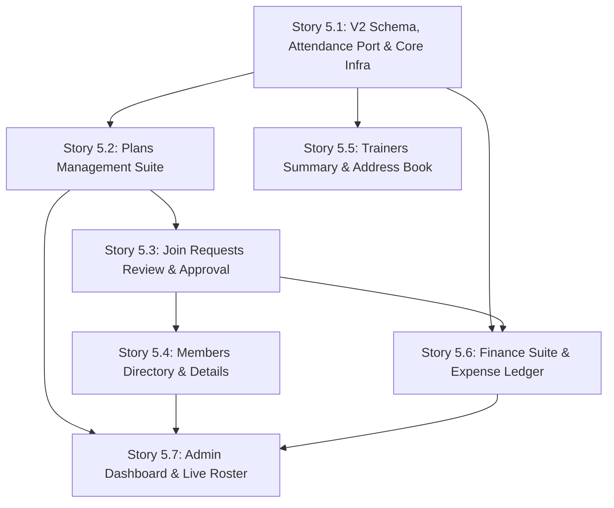

# Phase 5: In-Gym Tenant Administration Module — Dependency Matrix & Implementation Ordering

This document establishes the dependency relationships, critical path, and execution sequence for **Phase 5: In-Gym Tenant Administration Module** of `GymVerse-Backend-v2`.

---

## 1. Story Dependency Matrix

| Story ID | Story Title | Immediate Dependencies | Cross-Cutting Dependencies | Blocks / Enables |
| :--- | :--- | :--- | :--- | :--- |
| **Story 5.1** | **Phase 5 Schema (`V2`), Reusable Attendance Port & Subfolder Core Infrastructure** | Phase 4 Complete (`TenantAdminController`, `TenantAdminFactory`, `TenantFlywayService`) | `V2__phase5_tenant_admin_extensions.sql`, `AttendanceQueryPort`, `PlanTheme`, `helper/`, `application.yaml` | Stories 5.2, 5.3, 5.4, 5.5, 5.6, 5.7 |
| **Story 5.2** | **Plans Management Suite** | Story 5.1 | `PlanTier`, `GymFacility`, `MembershipPlan`, `MembershipPlanSpecification` | Story 5.3 (plans assigned on join approval), Story 5.4, Story 5.7 |
| **Story 5.3** | **Join Requests Review & Approval Workflow** | Stories 5.1, 5.2 | `JoinRequest`, `TenantUser`, `Member`, `MemberMembership`, `Revenue`, Central `UserTenantRole`, `GymSubscription` | Story 5.4 (approved members appear in directory), Story 5.6, Story 5.7 |
| **Story 5.4** | **Members Directory, Mini-Dashboard & Member Details View** | Stories 5.1, 5.2, 5.3 | `MemberSpecification`, `AttendanceQueryPort`, `MembershipCalculationHelper` | Story 5.7 (Dashboard & Live Roster share member status semantics) |
| **Story 5.5** | **Trainers & Staff Summary & Address Book** | Story 5.1 | `Trainer`, `TrainerSpecification`, `AttendanceQueryPort` | Independent of 5.2–5.4 after 5.1 |
| **Story 5.6** | **Finance Analytics Suite & Expense Ledger** | Stories 5.1, 5.3 | `Revenue`, `Expense`, `ExpenseSpecification`, `FinancePeriodHelper` | Story 5.7 (Dashboard reuses revenue breakdown semantics) |
| **Story 5.7** | **Admin Dashboard, Live Roster Gateway & API Docs** | Stories 5.1, 5.2, 5.3, 5.4, 5.6 | `AttendanceQueryPort`, `MembershipPlan`, `Member`, `MemberMembership`, `Revenue`, `docs/payloads.md` | Completes Phase 5 Tenant Admin operational suite |

---

## 2. Dependency Graph & Critical Path

---

## 3. Recommended Execution Order

1. **Story 5.1** — Foundation: V2 Flyway migration, JPA entities/repositories with `JpaSpecificationExecutor`, `PlanTheme` (defaults + 20 custom themes), `AttendanceQueryPort` stub, subfolder restructure of existing `tenantAdmin`, and shared helpers.
2. **Story 5.2** — Plans Page: Summary, filter options, paginated/filtered plans, create plan (default/custom tiers + custom facilities), toggle availability.
3. **Story 5.3** — Join Requests Tab: Fetch join requests (paginated + JPA Spec), approve (with `PAID`/`PARTIALLY_PAID` + `paidAmount` + `Revenue` + Central `UserTenantRole`), reject.
4. **Story 5.4** — Members Page: Summary (`total`, `live`, `expired`, `trial`), paginated/filtered directory, Member Details view (attendance stub + membership + payment + contact cards).
5. **Story 5.5** — Trainers Page: Summary (`total`, commented `live` & `avgAttendanceRate`) and searchable/paginated trainer address book.
6. **Story 5.6** — Finance Page: `WEEKLY`/`MONTHLY`/`YEARLY` analytics overview, expense/collection/revenue breakdowns, paginated expense ledger, create expense.
7. **Story 5.7** — Dashboard & Live Roster Pages: Complete Admin Dashboard (`FETCH_ADMIN_DASHBOARD`), Live Roster (`FETCH_LIVE_ROSTER` stubbed cleanly via `AttendanceQueryPort`), and full `docs/payloads.md` documentation.
