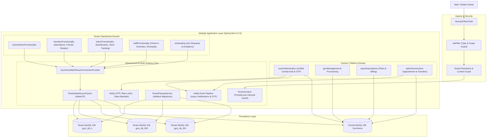
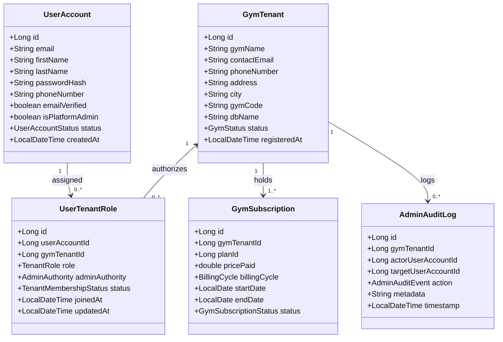
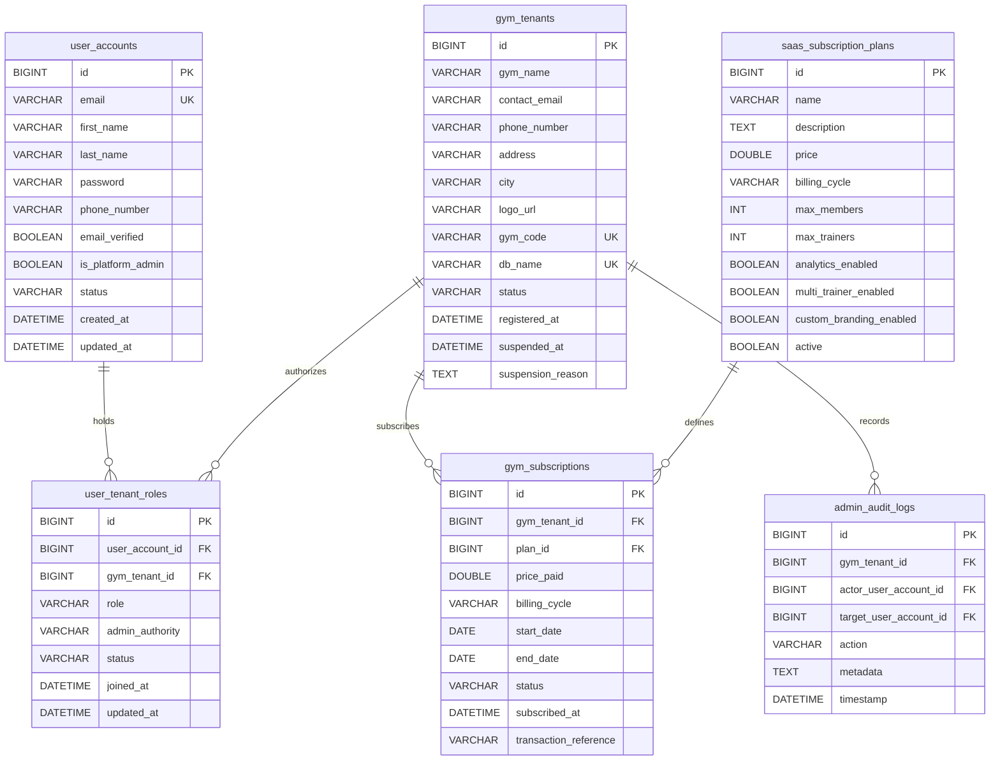
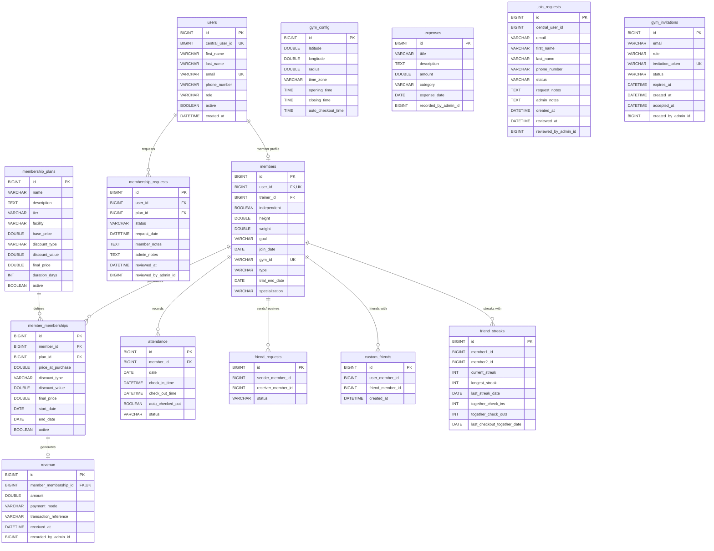
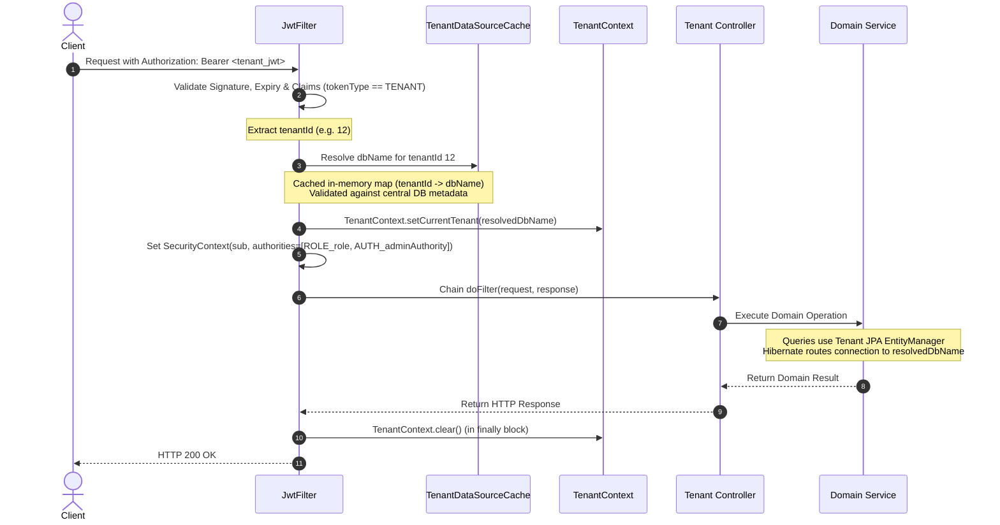
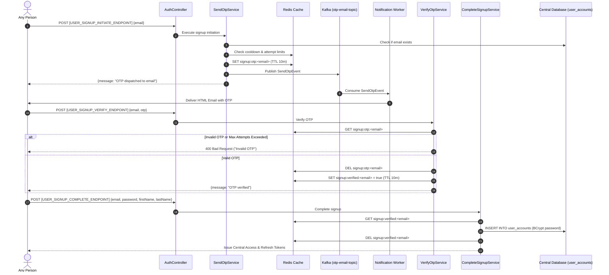
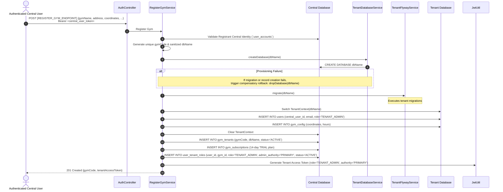
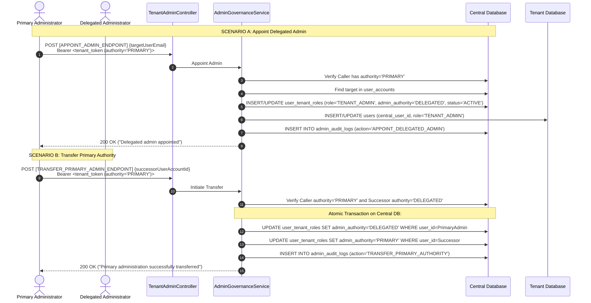
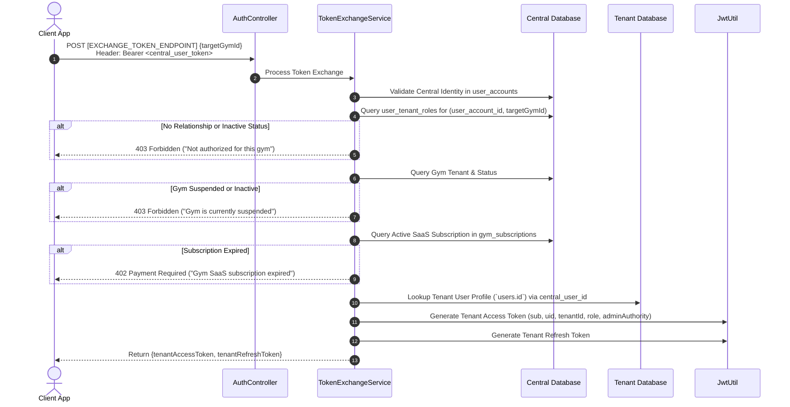
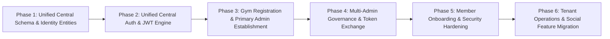

# GymVerse — Target Technical Architecture & Controlled Refactoring Specification

> **Document Status:** Architectural Target Specification (Revision v2.1 — Unified Identity & Tenant Administration)  
> **Audience:** Engineering Leadership, System Architects, Backend Engineers  
> **Author:** Winston, System Architect 🏗️  
> **Version:** 2.1 (Target)  
> **Project Repository:** `GymVerse-Backend-v2`  
> **Date:** October 2026

---

## 1. Architectural Mission & Core Paradigms

GymVerse is a multi-tenant Gym Management SaaS platform built as a secure, scalable, production-grade modular monolith. 

### 1.1 Invariants & Non-Negotiables
1. **Modular Monolith:** Single deployable Spring Boot application with strictly packaged domain modules, avoiding microservice operational overhead while enforcing clean architectural boundaries.
2. **Database-Per-Tenant Isolation:** Complete physical database separation for each gym tenant (`gym_db_<id>`), backed by a single central platform database (`GymVerse`).
3. **Single Central Identity (`user_accounts`):** Exactly one central identity system for every human who uses GymVerse. The legacy separation between `accounts` and `user_accounts` is retired. All authentication credentials, OTPs, and profile baselines reside centrally.
4. **No Owner Role:** The separate `OWNER` authorization role is eliminated. Business, legal, and operational governance derives from a tenant-level administrative relationship (`TENANT_ADMIN`).
5. **Multi-Admin Hierarchy per Tenant:** Tenants support multiple active administrators. Authority is governed by an explicit attribute: **Primary Tenant Administrator** (exactly one active per tenant) versus **Delegated Tenant Administrators** (zero or more).
6. **Zero-Trust Server-Side Tenant Resolution:** The application never trusts client-provided database names or arbitrary tenant headers. The physical database is resolved solely through verified central mappings and active subscription checks.
7. **Two-Tier Authentication & Token Exchange:** Central authentication produces a central token (`CENTRAL_USER`). Accessing a gym requires exchanging the central token for a verified, cryptographically signed `TENANT` token.
8. **Zero Credential Duplication:** Passwords exist solely in the central database. Tenant databases contain only profile data and stable linking identifiers (`central_user_id`).

---

## 2. System Architecture & High-Level Topology



---

## 3. Unified Identity & Tenant Administration Model



### 3.1 Single Central Identity (`user_accounts`)
- **Scope:** Every human using GymVerse.
- **Capabilities:**
  - Can register a gym and become its Primary Administrator.
  - Can be appointed as a Delegated Administrator of another gym.
  - Can join one or more gyms as a Member.
  - Can be hired as a Trainer or Staff member in one or more gyms.
- **Credentials:** A single email, password, and multi-factor/OTP verification lifecycle.

### 3.2 Tenant Administrative Hierarchy
- **Primary Tenant Administrator (`TENANT_ADMIN` with `adminAuthority = PRIMARY`):**
  - Assigned upon registering the gym tenant.
  - Exactly **one active** Primary Administrator per gym tenant.
  - Has sovereign authority to:
    - Manage SaaS subscription, billing cycles, and payment methods.
    - Appoint Delegated Administrators from existing central identities or via invite.
    - Revoke Delegated Administrators.
    - Initiate and execute an explicit, audited transfer of primary authority to an active Delegated Administrator.
- **Delegated Tenant Administrator (`TENANT_ADMIN` with `adminAuthority = DELEGATED`):**
  - Appointed by the Primary Administrator.
  - Zero or more active per gym tenant.
  - Has full operational authority over daily facility operations (memberships, join requests, invitations, finances, geofencing).
  - Restricted from appointing/revoking other administrators, transferring primary authority, or deleting/suspending the gym tenant.

### 3.3 Tenant-Scoped Role Taxonomy
Roles exist strictly within the context of a specific gym tenant:
1. `TENANT_ADMIN`: Primary or delegated facility governance.
2. `MEMBER`: Workout facility access, check-ins, social streaks.
3. `TRAINER`: Client assignment, workout logs, trainer dashboards.
4. `STAFF`: Front-desk check-in overrides, membership plan sales.

---

## 4. Database Schema Specifications

### 4.1 Central Platform Schema (`GymVerse`)



#### Central Constraints & Invariants:
1. `uq_utr_user_gym_role`: `UNIQUE(user_account_id, gym_tenant_id, role)` on `user_tenant_roles`.
2. `idx_utr_user_status`: Index on `user_tenant_roles(user_account_id, status)`.
3. `idx_utr_gym_role`: Index on `user_tenant_roles(gym_tenant_id, role, admin_authority)`.
4. **Primary Admin Invariant:** A filtered unique index or application-layer guarded transaction enforces that at most one row per `gym_tenant_id` can have `role = 'TENANT_ADMIN'` AND `admin_authority = 'PRIMARY'` AND `status = 'ACTIVE'`.
5. `idx_gym_code`: `UNIQUE(gym_code)` on `gym_tenants`.
6. `idx_db_name`: `UNIQUE(db_name)` on `gym_tenants`.

---

### 4.2 Tenant Operational Schema (`gym_db_<id>`)



---

## 5. Token Contract & Authorization Architecture

### 5.1 Token Classification Matrix

| Token Name | Token Scope | Issued By | `sub` Claim | Primary Claims | Intended Purpose |
| :--- | :--- | :--- | :--- | :--- | :--- |
| **Central Access Token** | Platform / Global | `USER_LOGIN_ENDPOINT` | `user:<id>` | `tokenType: CENTRAL_USER`, `type: ACCESS`, `isPlatformAdmin: boolean` | Query accessible gyms, register gyms, exchange for tenant-scoped token |
| **Tenant Access Token** | Gym / Tenant | `EXCHANGE_TOKEN_ENDPOINT` | `user:<id>` | `tokenType: TENANT`, `tenantId: <id>`, `uid: <local_user_id>`, `role: <ROLE>`, `adminAuthority: PRIMARY/DELEGATED/NONE`, `type: ACCESS` | Access operational gym APIs (Member, Trainer, Staff, Tenant-Admin) |
| **Central Refresh Token** | Global Refresh | Central Login | `user:<id>` | `type: REFRESH`, `jti: <uuid>` | Rotate and renew Central Access Tokens |
| **Tenant Refresh Token** | Tenant Refresh | Token Exchange | `user:<id>` | `type: REFRESH`, `tenantId: <id>`, `jti: <uuid>` | Rotate and renew Tenant Access Tokens |

### 5.2 Exact Tenant Access Token Claims Contract

```json
{
  "iss": "https://auth.gymverse.com",
  "sub": "user:10042",
  "uid": 852,
  "tenantId": 12,
  "tokenType": "TENANT",
  "type": "ACCESS",
  "role": "TENANT_ADMIN",
  "adminAuthority": "PRIMARY",
  "iat": 1715000000,
  "exp": 1715000900,
  "jti": "e4b6c3d1-4f18-4b82-9c1a-289d0cf31821"
}
```

#### Detailed Claim Definitions:
- `sub`: Global identity namespace: `"user:<id>"`. Prevents identifier collisions.
- `uid`: The `users.id` primary key in that specific tenant's database. Enables tenant domain services to resolve local profiles without querying central DB.
- `tenantId`: Central database ID (`gym_tenants.id`).
- `tokenType`: Security domain identifier (`TENANT`).
- `role`: Active tenant authorization role (`TENANT_ADMIN`, `TRAINER`, `STAFF`, `MEMBER`).
- `adminAuthority`: Administrative level (`PRIMARY`, `DELEGATED`, or `NONE` for non-admins).
- `exp`: 15 minutes expiration (`900,000 ms`).

### 5.3 Zero-Trust Server-Side Tenant Resolution



---

## 6. Detailed Workflows & Sequence Diagrams

### 6.1 Central User Registration & OTP Flow



---

### 6.2 Gym Registration & Primary Admin Establishment



---

### 6.3 Delegated Administrator Appointment & Primary Authority Transfer



---

### 6.4 Gym Selection & Token Exchange Flow



---

## 7. Role & Permission Matrix

| Role | Admin Authority | Permitted Operations | Restricted Operations |
| :--- | :--- | :--- | :--- |
| **PLATFORM_ADMIN** | N/A (Platform Scope) | Manage global SaaS plans, inspect all gym metadata, suspend/restore gyms, system health | Operational gym attendance, member records |
| **TENANT_ADMIN** | **PRIMARY** | Manage gym SaaS billing, appoint/revoke delegated admins, transfer primary authority, all operational duties | Modify other gyms' data, access platform admin APIs |
| **TENANT_ADMIN** | **DELEGATED** | Review join requests, invite members/staff/trainers, create membership plans, record revenue/expenses, configure geofencing | Appoint/revoke admins, transfer primary authority, alter SaaS billing |
| **TRAINER** | NONE | View trainer dashboard, view client streaks & attendance, record workout coaching notes | Manage plans, review join requests, access financial records |
| **STAFF** | NONE | Front-desk check-in overrides, browse member list, assist plan renewals | Create/delete plans, record facility expenses, change geofencing |
| **MEMBER** | NONE | GPS Check-in/out, browse catalog, submit plan request, search peers, friend requests, streaks | Any admin or staff endpoint, view other members' financial data |

---

## 8. Cross-Database Transaction & Compensation Protocol

Because the central database and tenant databases are physically distinct MySQL instances, a standard Spring `@Transactional` cannot provide two-phase commit (2PC) guarantees across them.

### 8.1 Dual-Write Compensation Strategy
For operations that modify both Central and Tenant databases (e.g. Gym Registration, Admin Appointment, Join Request Approval):

1. **Local-First Ordering:**
   - Execute the non-reversible or physical infrastructure step first (e.g., MySQL database creation).
   - If subsequent steps fail, trigger an explicit compensatory action:
     ```java
     try {
         tenantDatabaseService.createDatabase(dbName);
         tenantFlywayService.migrate(dbName);
         seedTenantConfigAndUser(dbName, ...);
         saveCentralTenantAndRole(...);
     } catch (Exception ex) {
         log.error("Provisioning failed. Initiating compensatory rollback for {}", dbName, ex);
         tenantDatabaseService.dropDatabase(dbName);
         throw new GymProvisioningException("Provisioning failed and was rolled back", ex);
     }
     ```
2. **Idempotency Guards:**
   - All cross-database synchronization operations must be idempotent.
   - If an administrative record exists in the central database but the tenant user record is missing, the reconciliation service creates the missing record on first token exchange without failing.
3. **Outbox / Async Event Replay:**
   - Asynchronous side effects (sending OTP emails, invitation notifications) are published through Kafka after the primary transaction commits. Consumers use idempotent message handlers keyed on event UUIDs.

---

## 9. Architectural Decision Records (ADRs)

### ADR-1: Unified Central Identity Model (`user_accounts`)
- **Status:** Approved
- **Context:** The legacy separation of `accounts` (owners/admins) and `user_accounts` (members/trainers) created artificial barriers, prevented gym owners from being members elsewhere, and led to duplicate identity schemas.
- **Decision:** Consolidate all humans into a single central identity table: `user_accounts`.
- **Consequences:** Simplifies authentication controllers and JWT generation. Enables true multi-gym participation across any role under a single login.

### ADR-2: Elimination of the Owner Role in Favor of Primary Tenant Administration
- **Status:** Approved
- **Context:** An `OWNER` authorization role conflated business equity with operational permissions and made delegating gym administration awkward.
- **Decision:** Eliminate the `OWNER` role completely. Represent facility governance via `TENANT_ADMIN`, distinguished by an explicit authority flag (`admin_authority = PRIMARY | DELEGATED`).
- **Consequences:** Clear governance boundaries. Supports multi-admin gyms naturally while guaranteeing exactly one active Primary Administrator responsible for billing and administrative governance.

### ADR-3: Single Authoritative Credential Store
- **Status:** Approved
- **Context:** Legacy designs stored password hashes in both central and tenant databases.
- **Decision:** Eliminate password columns from tenant databases. All authentication occurs centrally against `user_accounts`. Tenant `users` tables store only profile attributes and `central_user_id`.
- **Consequences:** Eliminates credential desynchronization. Centralizes password rotation, reset, and account lockout.

### ADR-4: Zero-Trust Server-Side Tenant Resolution
- **Status:** Approved
- **Context:** Earlier prototypes accepted `dbName` directly from client JWT claims, trusting client tokens for database routing.
- **Decision:** Remove `dbName` from tokens. Tokens carry only `tenantId`. The server resolves `dbName` via a cached central lookup and enforces active subscription status on every request.
- **Consequences:** Internal database topology remains completely concealed from clients. Facilitates instant tenant suspension and migration.

### ADR-5: Two-Tier Token Exchange Architecture
- **Status:** Approved
- **Context:** Single global tokens grant excessive blast radius and cannot carry tenant-specific role context safely.
- **Decision:** Central authentication returns a Central Access Token. Accessing tenant APIs requires calling `EXCHANGE_TOKEN_ENDPOINT` to acquire a Tenant Access Token scoped strictly to the selected gym.
- **Consequences:** Eliminates privilege bleed between gyms. Allows users to switch gym contexts seamlessly without re-authenticating centrally.

---

## 10. Clean-Slate Schema Design for GymVerse-Backend-v2

Because `GymVerse-Backend-v2` is scaffolded as a clean foundation, the database migrations can be initialized directly with clean target schemas rather than incrementally patching legacy columns:

1. **Central Schema (`V1__init_central_schema.sql`):**
   - `user_accounts` (unified central identity, BCrypt passwords, verification flags).
   - `gym_tenants` (gym code, database name, status).
   - `user_tenant_roles` (relationships connecting central identity to gym tenants with roles and `admin_authority`).
   - `saas_subscription_plans` (platform tiers and billing cycles).
   - `gym_subscriptions` (gym tenant subscription records).
   - `admin_audit_logs` (audit history for admin appointments and transfers).

2. **Tenant Schema (`V1__init_tenant_schema.sql`):**
   - `users` (tenant-local profile with `central_user_id`, no password column).
   - `gym_config` (geofence latitude/longitude/radius, hours).
   - `members` (member profile linked to `users.id`).
   - `membership_plans` (catalog of plans offered by this gym).
   - `member_memberships` (purchased plans).
   - `membership_requests` (plan purchase requests).
   - `attendance` (geofenced check-in/out records).
   - `revenue` & `expenses` (financial records).
   - `join_requests` (membership applications from central users).
   - `gym_invitations` (invitations issued to trainers, staff, or members).
   - `friend_requests`, `custom_friends`, `friend_streaks` (social features).

---

## 11. Ordered Implementation Phases



- **Phase 1: Unified Central Schema & Identity Entities**
  - Implement `V1__init_central_schema.sql` in `db/migration/central`.
  - Create JPA entities and repositories in `com.company.GymVerse.models.central` and `com.company.GymVerse.repositories.central`.
- **Phase 2: Unified Central Auth & JWT Engine**
  - Implement unified central authentication service (signup initiation, OTP verification, signup completion, login, refresh).
  - Implement namespaced JWT generation (`CENTRAL_USER` token type).
  - Configure Redis-backed OTP caching and rate limiting.
- **Phase 3: Gym Registration & Primary Admin Establishment**
  - Implement gym registration workflow with automated database creation and Flyway migration.
  - Establish registrant as Primary Tenant Administrator in `user_tenant_roles`.
  - Provision default 14-day trial subscription in `gym_subscriptions`.
- **Phase 4: Multi-Admin Governance & Token Exchange**
  - Implement Delegated Admin appointment and authority transfer services.
  - Implement `EXCHANGE_TOKEN_ENDPOINT` with subscription and role verification to issue `TENANT` tokens.
- **Phase 5: Member Onboarding & Security Hardening**
  - Implement `V1__init_tenant_schema.sql` in `db/migration/tenant`.
  - Create tenant entities and repositories in `models.tenant` and `repositories.tenant`.
  - Implement zero-trust `JwtFilter` with server-side database name resolution and route protection.
- **Phase 6: Tenant Operations & Social Feature Migration**
  - Implement member check-in/out with `GeoUtil` geofencing.
  - Implement friendship, streaks, and trainer workflows.
  - Build automated integration test suite validating end-to-end flows.
